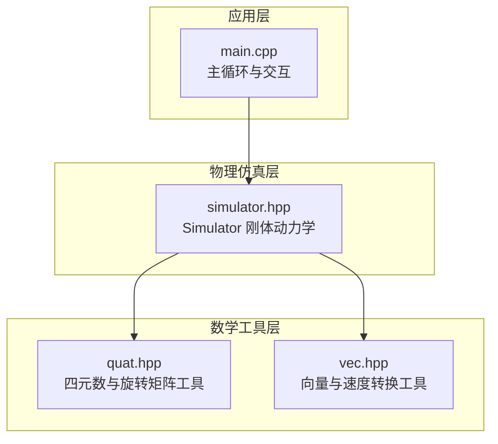
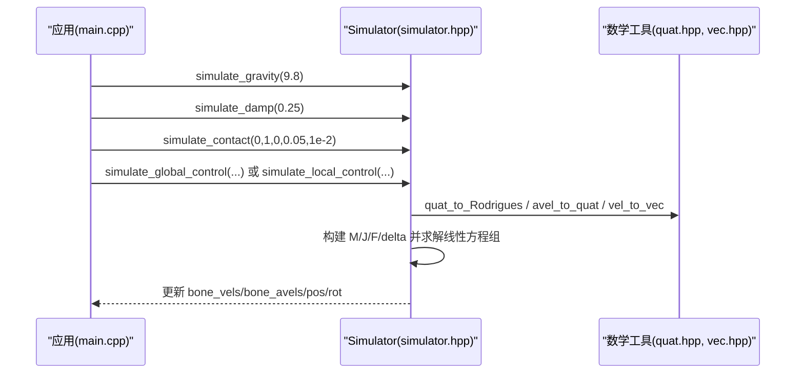
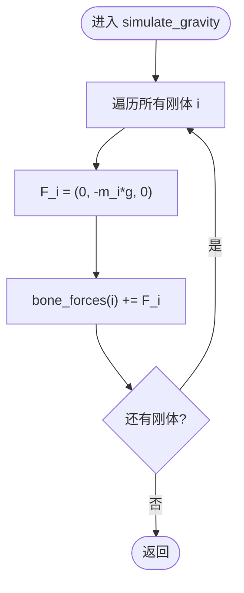
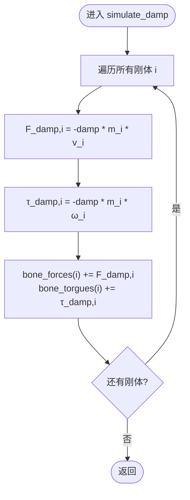
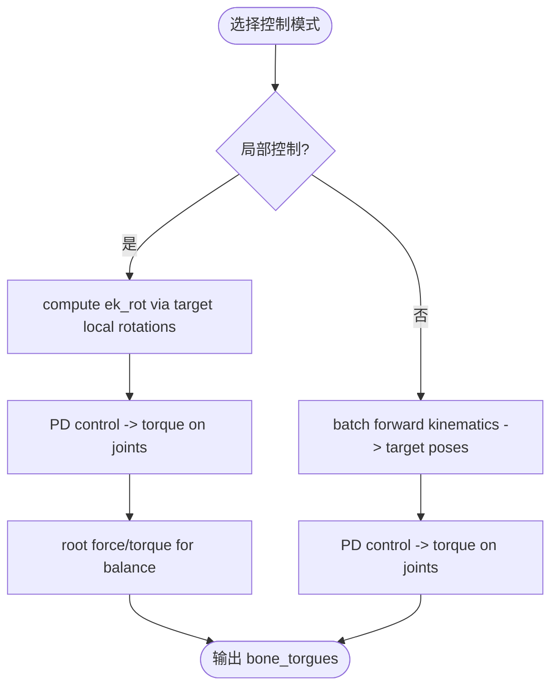
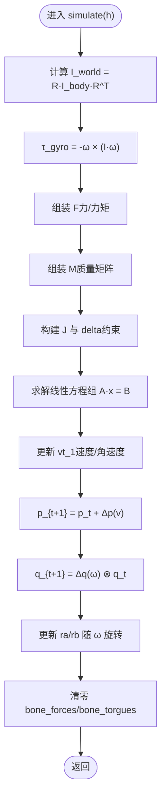
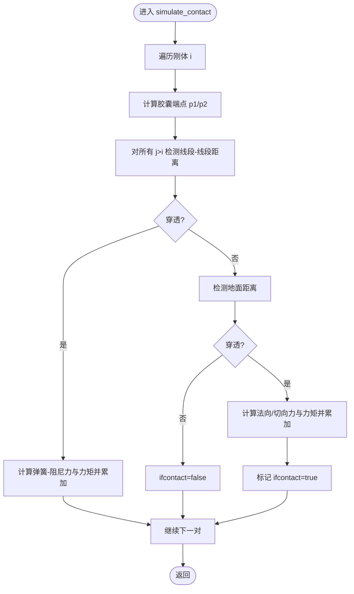
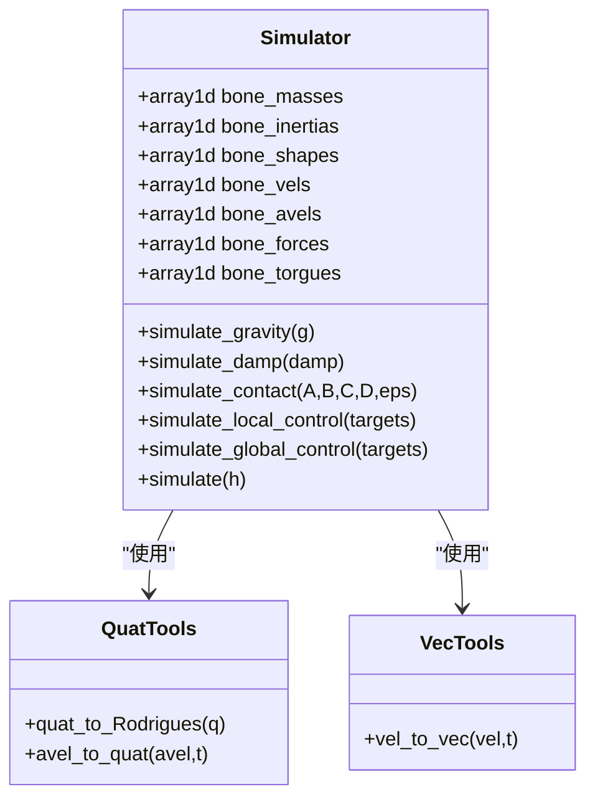

# 刚体动力学

> **版本提示（2.0）**：本文撰写于 1.x 时期，描述的是旧的实现形态——入口在根目录 `main.cpp`，功能由根目录 `.hpp` 头文件库提供，窗口用 raylib、显示用 OpenCV highgui。2.0 已把这些头文件移到 `Source/Legacy/`，渲染默认走 GPU，窗口与 UI 换成 GLFW + ImGui，`main.cpp` 拆成 `Source/Launch/Private/` 下的 `Main.cpp` 与 `Application`。文中的文件路径、行号与调用链可能已失效，请以根目录的「项目概述」「快速开始」「故障排除」三篇与当前源码为准。

<cite>
**本文引用的文件**   
- [simulator.hpp](file://simulator.hpp)
- [main.cpp](file://main.cpp)
- [quat.hpp](file://quat.hpp)
- [vec.hpp](file://vec.hpp)
</cite>

## 目录
1. [简介](#简介)
2. [项目结构](#项目结构)
3. [核心组件](#核心组件)
4. [架构总览](#架构总览)
5. [详细组件分析](#详细组件分析)
6. [依赖关系分析](#依赖关系分析)
7. [性能考虑](#性能考虑)
8. [故障排查指南](#故障排查指南)
9. [结论](#结论)
10. [附录：使用示例与参数调优](#附录使用示例与参数调优)

## 简介
本技术文档聚焦于 MooLab 中的刚体动力学系统，重点解析 Simulator 类对刚体物理状态的管理、重力模拟、阻尼模型、力矩控制机制（局部/全局）以及运动方程的离散化与数值积分过程。文档面向具备一定工程背景的读者，同时尽量以循序渐进的方式解释数学与代码实现之间的对应关系。

## 项目结构
MooLab 是一个角色运动渲染与仿真器，包含骨骼动画、相机、渲染、控制器等模块。刚体动力学相关逻辑集中在 simulator.hpp 中，主循环在 main.cpp 中调用模拟器方法完成每帧的物理更新。

图表来源
- [main.cpp:320-339](file://main.cpp#L320-L339)
- [simulator.hpp:321-355](file://simulator.hpp#L321-L355)
- [quat.hpp:202-221](file://quat.hpp#L202-L221)
- [vec.hpp:200-200](file://vec.hpp#L200-L200)

章节来源
- [README.md:1-22](file://README.md#L1-L22)
- [main.cpp:320-339](file://main.cpp#L320-L339)

## 核心组件
Simulator 是刚体动力学系统的核心，管理以下关键数据与行为：
- 刚体质量与惯性矩阵：bone_masses、bone_inertias
- 刚体位姿与形状：bone_shapes（位置 pos、旋转 rot、半径 radius、长度 length、接触标志 ifcontact）
- 速度与角速度：bone_vels、bone_avels
- 外力与外力矩：bone_forces、bone_torgues
- 约束与拓扑：bone_links（连接 a/b、ra/rb、delta）
- 控制辅助：accumulated_ek_rots、last_ek_rots（用于 PD 控制累积项与微分项）

主要接口：
- simulate_gravity(g)：施加重力
- simulate_damp(damp)：线性阻尼与角阻尼
- simulate_contact(A,B,C,D,eps)：碰撞检测与反作用力
- simulate_local_control(target_local_rotations)：局部力矩控制
- simulate_global_control(target_local_rotations)：全局力矩控制
- simulate(h)：求解运动方程并推进时间步

章节来源
- [simulator.hpp:321-355](file://simulator.hpp#L321-L355)

## 架构总览
下图展示了从主循环到物理仿真的调用链，以及各方法的职责分工。

图表来源
- [main.cpp:320-339](file://main.cpp#L320-L339)
- [simulator.hpp:357-372](file://simulator.hpp#L357-L372)
- [simulator.hpp:374-435](file://simulator.hpp#L374-L435)
- [simulator.hpp:437-541](file://simulator.hpp#L437-L541)
- [simulator.hpp:543-624](file://simulator.hpp#L543-L624)
- [quat.hpp:202-221](file://quat.hpp#L202-L221)
- [vec.hpp:200-200](file://vec.hpp#L200-L200)

## 详细组件分析

### 刚体物理状态管理
- 质量与惯性矩阵
  - bone_masses：每个刚体的质量标量，用于计算重力 F = m·g 和惯性项。
  - bone_inertias：初始惯性张量（在物体坐标系下），通过旋转矩阵变换到世界坐标系：I_world = R·I_body·R^T。
- 速度与角速度
  - bone_vels：质心线速度。
  - bone_avels：角速度。
- 位姿与形状
  - bone_shapes.pos/rot：当前世界坐标下的位置与四元数旋转。
  - bone_shapes.radius/length：胶囊体近似几何参数，用于碰撞检测。
  - bone_shapes.ifcontact：是否接触地面或其他刚体。
- 力与力矩
  - bone_forces：外部力（重力、阻尼、碰撞反作用力）。
  - bone_torgues：外部力矩（阻尼、控制、碰撞产生的力矩）。
- 约束
  - bone_links：描述相邻刚体间的连接关系，ra/rb 为连接点在各自刚体上的局部偏移，delta 为约束误差。

章节来源
- [simulator.hpp:321-355](file://simulator.hpp#L321-L355)
- [simulator.hpp:543-624](file://simulator.hpp#L543-L624)

### 重力模拟原理
simulate_gravity(g) 对每个刚体施加向下的重力：
- 力的方向：沿负 Y 轴
- 大小：F_i = m_i · g
- 实现方式：将重力累加到 bone_forces[i]

图表来源
- [simulator.hpp:357-363](file://simulator.hpp#L357-L363)

章节来源
- [simulator.hpp:357-363](file://simulator.hpp#L357-L363)

### 阻尼效果的数学模型
simulate_damp(damp) 同时引入线性阻尼与角阻尼：
- 线性阻尼：F_damp,i = -c · m_i · v_i
- 角阻尼：τ_damp,i = -c · m_i · ω_i
其中 c 为阻尼系数（damp），v_i 为线速度，ω_i 为角速度。该模型将阻尼力/力矩直接累加到 bone_forces 与 bone_torgues。

图表来源
- [simulator.hpp:365-372](file://simulator.hpp#L365-L372)

章节来源
- [simulator.hpp:365-372](file://simulator.hpp#L365-L372)

### 力矩控制机制：局部 vs 全局
- 局部控制 simulate_local_control(target_local_rotations)
  - 基于目标局部旋转差值计算期望角速度 ek_rot，并通过 PD 控制生成力矩：
    - P 项：k_p · ek_rot
    - I 项：k_i · accumulated_ek_rots（累积误差）
    - D 项：k_d · (ek_rot - last_ek_rots)
  - 对根节点额外施加水平位移控制力，以调整整体重心位置。
  - 特点：符合物理（力矩作用于关节），但需要仔细调节参数以获得稳定效果。
- 全局控制 simulate_global_control(target_local_rotations)
  - 先通过批量前向运动学得到目标位姿，再计算各关节的 ek_rot 并施加 PD 力矩。
  - 特点：不严格满足牛顿-欧拉约束，但视觉效果较好，常用于快速匹配动画姿态。

图表来源
- [simulator.hpp:437-510](file://simulator.hpp#L437-L510)
- [simulator.hpp:512-541](file://simulator.hpp#L512-L541)

章节来源
- [simulator.hpp:437-510](file://simulator.hpp#L437-L510)
- [simulator.hpp:512-541](file://simulator.hpp#L512-L541)

### 刚体运动方程求解与数值积分
simulate(h) 实现了基于牛顿-欧拉方程的离散化与约束求解流程：
- 步骤概览
  1) 计算瞬时惯性矩阵 I_world = R·I_body·R^T
  2) 加入陀螺力矩项：τ_gyro = -ω × (I·ω)
  3) 组装广义力向量 F（含外力和力矩）
  4) 组装质量矩阵 M（平移与旋转部分）
  5) 构建约束雅可比 J 与约束误差 delta
  6) 求解增广线性方程组（M + J^T·λ 形式）得到新速度 vt_1
  7) 更新速度与角速度，并积分位姿：
     - p_{t+1} = p_t + Δp(v)
     - q_{t+1} = Δq(ω) ⊗ q_t
  8) 更新约束点 ra/rb 随角速度旋转
  9) 清零本帧力与力矩

图表来源
- [simulator.hpp:543-624](file://simulator.hpp#L543-L624)
- [quat.hpp:202-221](file://quat.hpp#L202-L221)
- [vec.hpp:200-200](file://vec.hpp#L200-L200)

章节来源
- [simulator.hpp:543-624](file://simulator.hpp#L543-L624)

### 碰撞检测与反作用力
simulate_contact(A,B,C,D,eps) 支持：
- 刚体间碰撞：通过线段-线段距离判断，若穿透则施加弹簧-阻尼反作用力，并产生相应力矩。
- 地面碰撞：平面方程 Ax + By + Cz + D = 0，计算距离与法向，施加法向与切向摩擦力，并标记 ifcontact。

图表来源
- [simulator.hpp:374-435](file://simulator.hpp#L374-L435)

章节来源
- [simulator.hpp:374-435](file://simulator.hpp#L374-L435)

## 依赖关系分析
- Simulator 依赖数学工具：
  - quat_to_Rodrigues：四元数转旋转矩阵，用于惯性矩阵的世界坐标变换。
  - avel_to_quat：角速度转四元数增量，用于位姿积分。
  - vel_to_vec：线速度转位移增量，用于位置积分。
- 主循环 main.cpp 负责调度：
  - 每帧依次调用重力、阻尼、碰撞、控制、仿真步进。

图表来源
- [simulator.hpp:321-355](file://simulator.hpp#L321-L355)
- [quat.hpp:202-221](file://quat.hpp#L202-L221)
- [vec.hpp:200-200](file://vec.hpp#L200-L200)

章节来源
- [simulator.hpp:321-355](file://simulator.hpp#L321-L355)
- [quat.hpp:202-221](file://quat.hpp#L202-L221)
- [vec.hpp:200-200](file://vec.hpp#L200-L200)

## 性能考虑
- 并行化：矩阵乘法已使用 OpenMP 进行并行加速（矩阵乘法的并行循环）。
- 时间步长 h：较小的 h 提高稳定性但增加计算量；建议根据场景复杂度与实时性需求调整。
- 阻尼与刚度参数：过大的 kp/kd 可能导致数值不稳定；需结合 h 与质量尺度进行调参。
- 约束规模：约束数量与刚体数量成正比，大规模骨架时注意线性方程组的求解成本。

[本节为通用指导，不直接分析具体文件]

## 故障排查指南
- 刚体发散或不稳定
  - 检查时间步长 h 是否过大；适当减小 h。
  - 检查阻尼系数 damp 与碰撞刚度 kp/kd 是否过高；逐步降低。
- 角色无法站立或频繁抖动
  - 检查重力 g 是否与单位制一致。
  - 检查惯性矩阵初始化是否合理；确保 I_body 正定且尺度与质量匹配。
- 控制效果不佳
  - 局部控制：调整 PD 参数 k_p/k_i/k_d，避免积分饱和（accumulated_ek_rots 溢出保护）。
  - 全局控制：确认目标旋转序列与骨骼拓扑一致。
- 碰撞异常
  - 检查平面方程参数 A,B,C,D 与 eps 设置。
  - 检查胶囊体半径与长度是否与几何一致。

章节来源
- [simulator.hpp:357-435](file://simulator.hpp#L357-L435)
- [simulator.hpp:437-541](file://simulator.hpp#L437-L541)

## 结论
Simulator 通过清晰的数据结构与模块化方法实现了刚体动力学仿真：重力与阻尼提供基础环境效应，碰撞检测保证物理合理性，局部/全局力矩控制提供不同风格的驱动策略，最终通过牛顿-欧拉方程的离散化与约束求解推进时间步。该设计兼顾了可解释性与可扩展性，适合用于角色动画与物理交互的混合仿真。

[本节为总结性内容，不直接分析具体文件]

## 附录：使用示例与参数调优
- 基本流程（每帧）
  - 调用重力：simulate_gravity(9.8)
  - 调用阻尼：simulate_damp(0.25)
  - 调用碰撞：simulate_contact(0,1,0,0.05,1e-2)
  - 选择控制：simulate_global_control(...) 或 simulate_local_control(...)
  - 步进仿真：simulate(dt/simulate_time)
- 参数建议
  - 重力 g：与单位制一致（例如 9.8 m/s²）
  - 阻尼 damp：0.1~0.5 范围起步，视质量与时间步调整
  - 碰撞刚度 kp/kd：kp 较大以保证刚性接触，kd 抑制振荡
  - 控制 PD：k_p 主导响应速度，k_d 抑制超调，k_i 消除稳态误差（谨慎使用）
- 参考路径
  - 主循环调用示例：[main.cpp:320-339](file://main.cpp#L320-L339)
  - 重力/阻尼/碰撞实现：[simulator.hpp:357-435](file://simulator.hpp#L357-L435)
  - 控制方法实现：[simulator.hpp:437-541](file://simulator.hpp#L437-L541)
  - 运动方程求解：[simulator.hpp:543-624](file://simulator.hpp#L543-L624)

章节来源
- [main.cpp:320-339](file://main.cpp#L320-L339)
- [simulator.hpp:357-624](file://simulator.hpp#L357-L624)