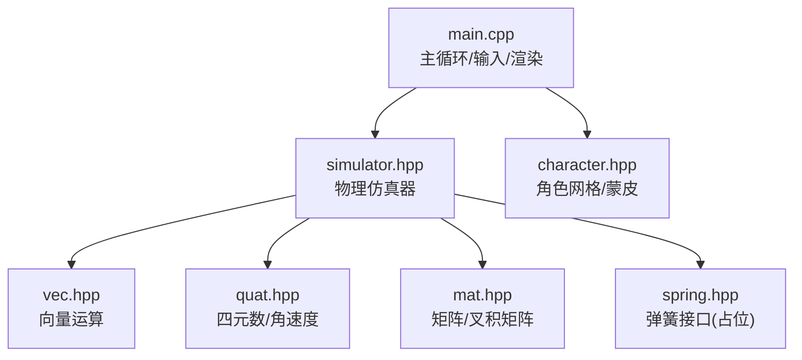
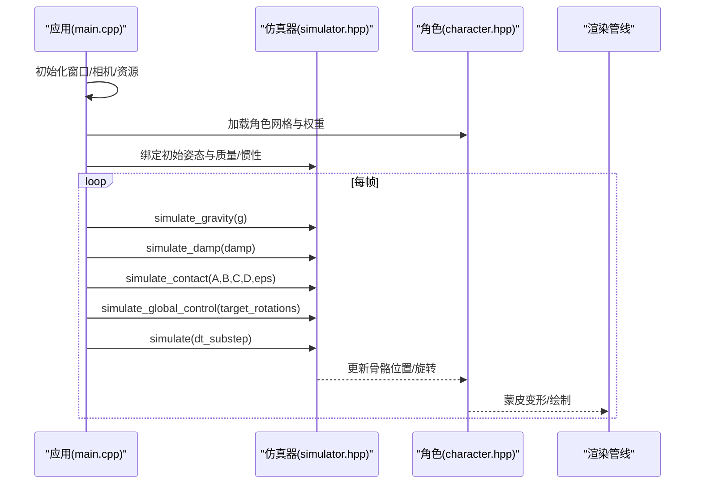
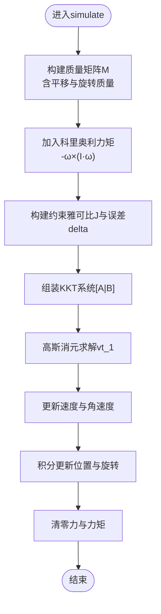
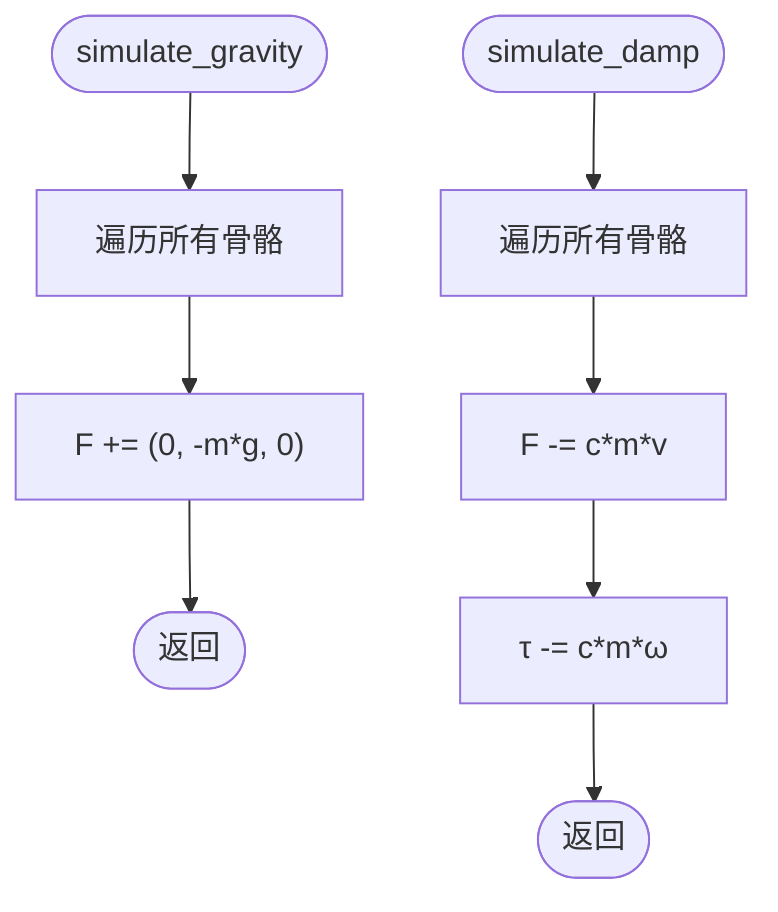
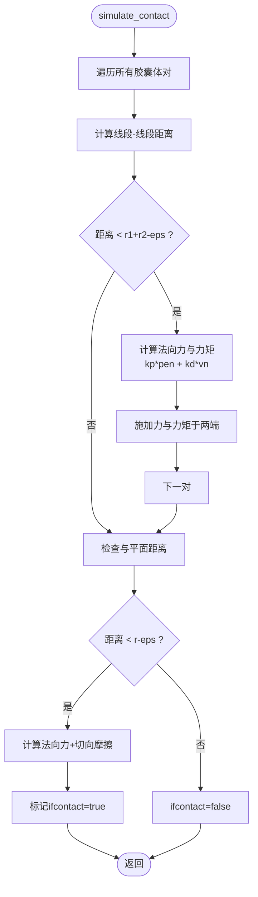
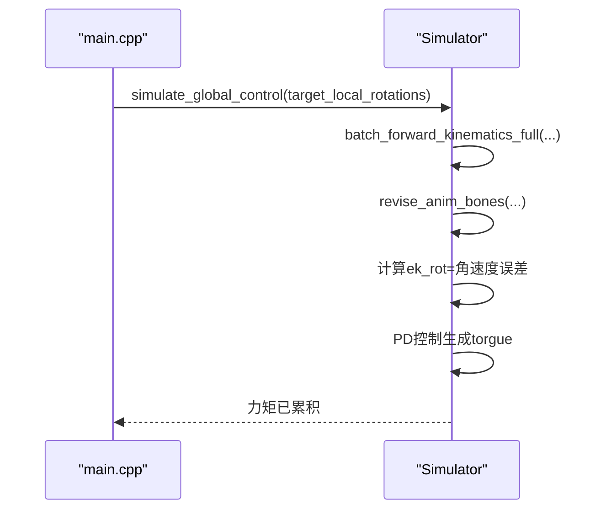
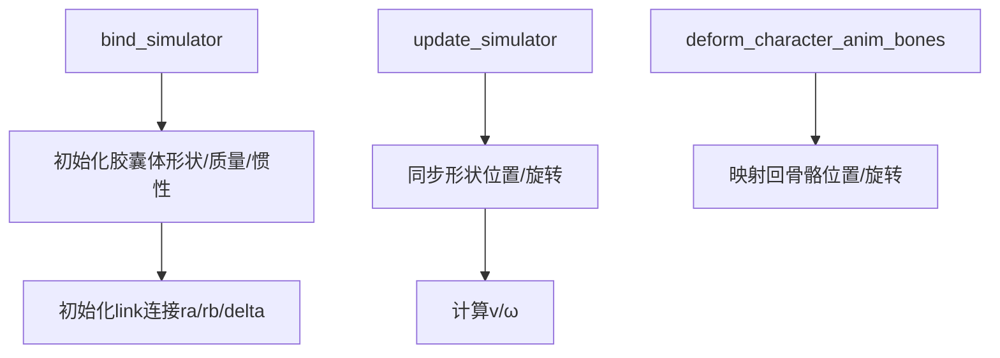
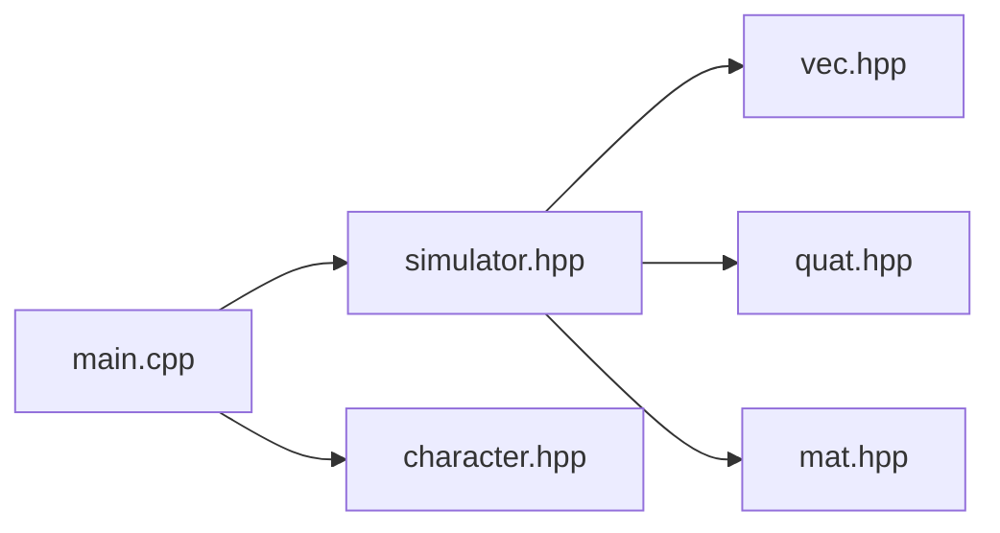

# 物理仿真系统

> **版本提示（2.0）**：本文撰写于 1.x 时期，描述的是旧的实现形态——入口在根目录 `main.cpp`，功能由根目录 `.hpp` 头文件库提供，窗口用 raylib、显示用 OpenCV highgui。2.0 已把这些头文件移到 `Source/Legacy/`，渲染默认走 GPU，窗口与 UI 换成 GLFW + ImGui，`main.cpp` 拆成 `Source/Launch/Private/` 下的 `Main.cpp` 与 `Application`。文中的文件路径、行号与调用链可能已失效，请以根目录的「项目概述」「快速开始」「故障排除」三篇与当前源码为准。

<cite>
**本文引用的文件**   
- [README.md](file://README.md)
- [main.cpp](file://main.cpp)
- [simulator.hpp](file://simulator.hpp)
- [character.hpp](file://character.hpp)
- [spring.hpp](file://spring.hpp)
- [vec.hpp](file://vec.hpp)
- [quat.hpp](file://quat.hpp)
- [mat.hpp](file://mat.hpp)
</cite>

## 目录
1. [引言](#引言)
2. [项目结构](#项目结构)
3. [核心组件](#核心组件)
4. [架构总览](#架构总览)
5. [详细组件分析](#详细组件分析)
6. [依赖关系分析](#依赖关系分析)
7. [性能与稳定性](#性能与稳定性)
8. [参数调优指南](#参数调优指南)
9. [故障排查](#故障排查)
10. [结论](#结论)

## 引言
本技术文档面向MooLab物理仿真系统，聚焦刚体动力学引擎、碰撞检测与响应、弹簧约束接口以及角色系统集成。文档从代码级实现出发，解释重力模拟、阻尼效果、力矩控制、胶囊体碰撞、地面接触与摩擦、约束求解等关键算法，并提供参数调优建议与典型仿真场景说明，帮助读者理解并扩展该系统。

## 项目结构
MooLab是一个基于raylib的实时渲染与仿真程序，核心逻辑集中在主循环中调用物理仿真器（Simulator），并通过角色骨骼动画驱动可视化模型。主要模块：
- 主程序与渲染管线：main.cpp
- 物理仿真器：simulator.hpp（刚体动力学、碰撞、约束）
- 角色网格与蒙皮：character.hpp
- 数学基础：vec.hpp, quat.hpp, mat.hpp
- 弹簧约束接口：spring.hpp（当前为占位）

图表来源
- [main.cpp:53-170](file://main.cpp#L53-L170)
- [simulator.hpp:321-355](file://simulator.hpp#L321-L355)
- [character.hpp:35-47](file://character.hpp#L35-L47)
- [vec.hpp:75-155](file://vec.hpp#L75-L155)
- [quat.hpp:6-24](file://quat.hpp#L6-L24)
- [mat.hpp:7-14](file://mat.hpp#L7-L14)

章节来源
- [README.md:1-22](file://README.md#L1-L22)
- [main.cpp:53-170](file://main.cpp#L53-L170)

## 核心组件
- 物理仿真器（Simulator）
  - 维护每根骨骼的质量、转动惯量、形状（胶囊体）、连接（link）、速度与角速度、外力与外力矩。
  - 提供重力、阻尼、碰撞检测与响应、局部/全局力矩控制、时间步进求解。
- 角色系统（Character）
  - 存储角色网格顶点、法线、纹理坐标、索引、骨骼权重与绑定信息，支持线性插值蒙皮。
- 数学库
  - vec3/quat/mat3等基础类型与常用运算（点乘、叉乘、归一化、Rodrigues公式、四元数到角速度等）。
- 弹簧约束（Spring）
  - 当前仅声明函数接口，未实现具体计算。

章节来源
- [simulator.hpp:321-355](file://simulator.hpp#L321-L355)
- [character.hpp:35-47](file://character.hpp#L35-L47)
- [vec.hpp:75-155](file://vec.hpp#L75-L155)
- [quat.hpp:6-24](file://quat.hpp#L6-L24)
- [mat.hpp:7-14](file://mat.hpp#L7-L14)
- [spring.hpp:1-21](file://spring.hpp#L1-L21)

## 架构总览
下图展示主循环如何驱动物理仿真与渲染：

图表来源
- [main.cpp:320-345](file://main.cpp#L320-L345)
- [simulator.hpp:357-624](file://simulator.hpp#L357-L624)
- [character.hpp:142-164](file://character.hpp#L142-L164)

## 详细组件分析

### 刚体动力学引擎
- 状态变量
  - 每根骨骼：位置、旋转、线速度、角速度、外力、外力矩、质量、转动惯量、形状（胶囊体半径/长度）、连接（link）。
- 时间步进
  - 构建广义质量矩阵M（平移+旋转），组装外力F与约束雅可比J、误差delta，求解线性方程组得到新速度，再积分更新位置与旋转。
- 关键步骤
  - 计算瞬时转动惯量矩阵（随姿态变化）。
  - 累积科里奥利项（角动量交叉项）到外力矩。
  - 对每个link构建约束雅可比J与误差delta。
  - 使用高斯消元法求解KKT型线性系统，得到速度增量。
  - 更新速度与角速度，积分位置和旋转，重置力和力矩。

图表来源
- [simulator.hpp:543-624](file://simulator.hpp#L543-L624)

章节来源
- [simulator.hpp:543-624](file://simulator.hpp#L543-L624)
- [mat.hpp:71-85](file://mat.hpp#L71-L85)
- [quat.hpp:182-210](file://quat.hpp#L182-L210)

### 重力与阻尼
- 重力
  - 对每根骨骼施加向下的重力：F = m * g * (-y)。
- 阻尼
  - 对线速度与角速度施加粘性阻尼：F_damp = -c * m * v；τ_damp = -c * m * ω。

图表来源
- [simulator.hpp:357-372](file://simulator.hpp#L357-L372)

章节来源
- [simulator.hpp:357-372](file://simulator.hpp#L357-L372)

### 碰撞检测与响应
- 几何表示
  - 每根骨骼用胶囊体表示：中心位置、朝向、半径、长度。
- 碰撞检测
  - 胶囊体间距离：线段-线段最短距离，若小于两半径之和减去阈值则判定碰撞。
  - 胶囊体与平面（地面）：线段-平面距离，若小于半径减阈值则判定接触。
- 碰撞响应
  - 法向弹性：采用弹簧-阻尼模型，kp*(穿透深度)+kd*(相对法向速度)，产生冲量式力与力矩。
  - 地面摩擦：切向摩擦力沿速度投影方向，系数约0.6倍法向力。
  - 标记接触标志ifcontact用于后续控制逻辑。

图表来源
- [simulator.hpp:374-435](file://simulator.hpp#L374-L435)
- [simulator.hpp:196-300](file://simulator.hpp#L196-L300)

章节来源
- [simulator.hpp:374-435](file://simulator.hpp#L374-L435)
- [simulator.hpp:196-300](file://simulator.hpp#L196-L300)

### 力矩控制（局部/全局）
- 全局控制
  - 通过批量前向运动学将目标局部旋转映射到全局姿态，计算期望角速度误差，生成PD控制器输出力矩，作用于各关节。
- 局部控制
  - 直接比较当前骨骼旋转与目标局部旋转，计算角速度误差，结合累积误差与微分项生成力矩；同时根据接触情况调整根部力矩以维持平衡。

图表来源
- [simulator.hpp:512-541](file://simulator.hpp#L512-L541)
- [simulator.hpp:634-662](file://simulator.hpp#L634-L662)

章节来源
- [simulator.hpp:437-541](file://simulator.hpp#L437-L541)
- [simulator.hpp:634-662](file://simulator.hpp#L634-L662)

### 弹簧约束系统
- 当前状态
  - spring.hpp仅声明了隐式阻尼衰减函数的接口（旋转与位置），但返回空向量，未参与实际仿真。
- 设计意图
  - 预留弹簧-阻尼接口，便于未来引入柔性约束或稳定化策略。

章节来源
- [spring.hpp:1-21](file://spring.hpp#L1-L21)

### 角色系统与物理集成
- 绑定阶段
  - bind_simulator根据BVH动作某一帧建立骨骼质量、惯性、形状与连接，并设置初始姿态。
- 更新阶段
  - update_simulator在仿真过程中同步角色骨骼位置/旋转到仿真器形状，并计算速度与角速度。
- 反演阶段
  - deform_character_anim_bones将仿真结果映射回骨骼空间，供蒙皮变形使用。

图表来源
- [simulator.hpp:664-847](file://simulator.hpp#L664-L847)
- [simulator.hpp:849-909](file://simulator.hpp#L849-L909)
- [simulator.hpp:911-930](file://simulator.hpp#L911-L930)

章节来源
- [simulator.hpp:664-930](file://simulator.hpp#L664-L930)

## 依赖关系分析
- Simulator依赖
  - 数学库：vec3、quat、mat3（Rodrigues、叉积矩阵、四元数到角速度等）。
  - 运动数据：BVH_Motion（通过bind_simulator传入）。
- main.cpp依赖
  - raylib（窗口/手柄输入）、OpenCV（图像显示）、renderer/camera/ui等子系统。
- character.hpp依赖
  - 蒙皮相关数据结构与线性插值函数。

图表来源
- [main.cpp:8-17](file://main.cpp#L8-L17)
- [simulator.hpp:321-355](file://simulator.hpp#L321-L355)
- [character.hpp:35-47](file://character.hpp#L35-L47)

章节来源
- [main.cpp:8-17](file://main.cpp#L8-L17)
- [simulator.hpp:321-355](file://simulator.hpp#L321-L355)
- [character.hpp:35-47](file://character.hpp#L35-L47)

## 性能与稳定性
- 并行化
  - 矩阵乘法使用OpenMP并行加速，提升大规模矩阵运算效率。
- 数值稳定性
  - 避免除零：在距离计算与归一化中加入小常数eps。
  - 约束求解：使用显式高斯消元，需保证矩阵非奇异；质量矩阵对角占优有助于稳定。
- 时间步长
  - 默认dt≈1/60s，可通过simulate_time进行子步进拆分提高稳定性。
- 碰撞刚度
  - kp较大（如10000）可抑制穿透，但可能引起数值振荡；kd用于阻尼抑制高频抖动。

章节来源
- [simulator.hpp:61-79](file://simulator.hpp#L61-L79)
- [simulator.hpp:374-435](file://simulator.hpp#L374-L435)
- [main.cpp:164-168](file://main.cpp#L164-L168)

## 参数调优指南
- 重力加速度g
  - 影响下落速度与落地冲击；通常取9.8，可根据单位尺度调整。
- 阻尼系数damp
  - 控制能量耗散；过大导致动作迟缓，过小导致抖动；推荐范围0.1~0.5。
- 碰撞刚度kp与阻尼kd
  - kp决定穿透恢复强度，kd抑制碰撞高频振动；地面接触时kd常高于刚体间碰撞。
- 摩擦系数
  - 地面切向摩擦系数约0.6；过高会导致“粘地”，过低会滑移。
- 质量与惯性
  - 质量影响重力与惯性响应；惯性矩阵影响旋转阻力；四肢较轻、躯干较重更自然。
- 控制增益
  - 全局/局部控制的PD增益（比例与微分）影响跟踪精度与稳定性；比例过大易震荡，微分过大易过阻尼。

实践建议
- 先调g与damp使基本运动稳定，再逐步增大kp至无可见穿透，最后微调kd消除抖动。
- 控制增益从较小值开始，逐步增加比例项，必要时加入微分项抑制超调。
- 质量分布遵循人体解剖近似：上肢轻、下肢重，躯干居中。

章节来源
- [simulator.hpp:357-435](file://simulator.hpp#L357-L435)
- [simulator.hpp:437-541](file://simulator.hpp#L437-L541)
- [simulator.hpp:692-804](file://simulator.hpp#L692-L804)

## 故障排查
- 穿透严重
  - 检查kp是否足够大；确认eps阈值合理；确保碰撞检测顺序正确。
- 抖动或爆炸
  - 降低kp或增大kd；减小dt或增加simulate_time；检查质量/惯性是否异常。
- 角色不落地或悬浮
  - 检查地面平面参数A,B,C,D；确认ifcontact标志更新；验证重力方向。
- 控制不稳定
  - 降低比例增益或增加微分增益；检查ek_rot是否被截断（>10重置累积）。
- 蒙皮错位
  - 确认deform_character_anim_bones映射正确；检查bone_quat_compensates补偿。

章节来源
- [simulator.hpp:374-435](file://simulator.hpp#L374-L435)
- [simulator.hpp:437-541](file://simulator.hpp#L437-L541)
- [simulator.hpp:911-930](file://simulator.hpp#L911-L930)

## 结论
MooLab的物理仿真系统以刚体动力学为核心，结合胶囊体碰撞与地面摩擦，实现了稳定的角色运动仿真。通过重力、阻尼、力矩控制与约束求解，系统在实时渲染环境下展现出可控且自然的动态行为。弹簧约束接口为未来扩展提供了空间。建议在调试时优先稳定基础物理参数，再逐步优化控制增益与质量分布，以获得更真实的角色运动效果。