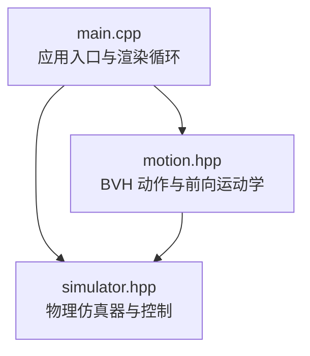
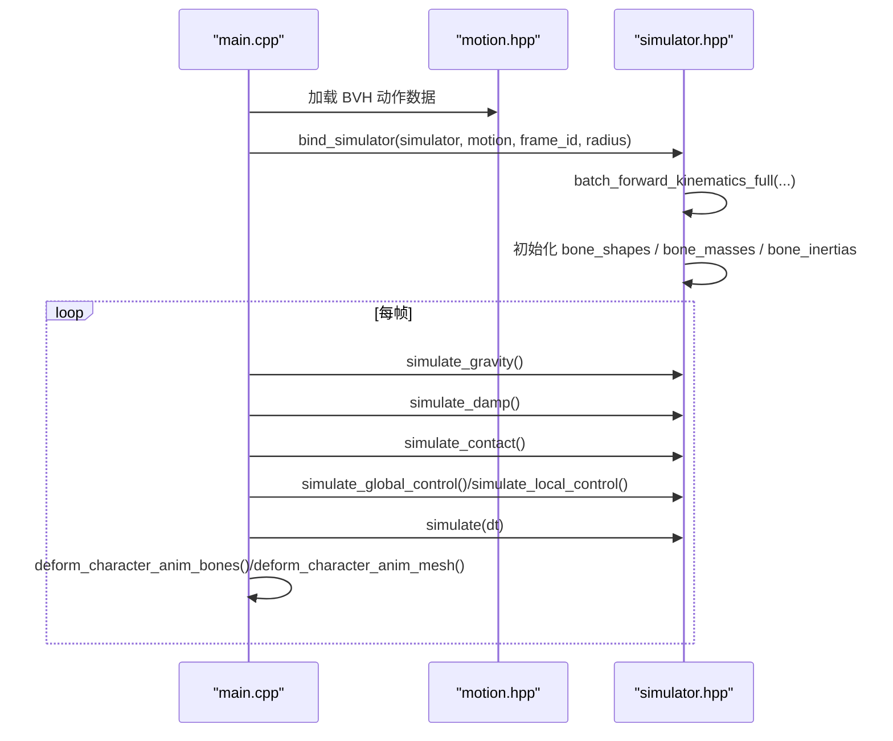
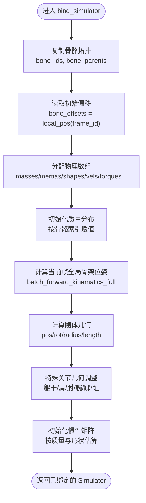
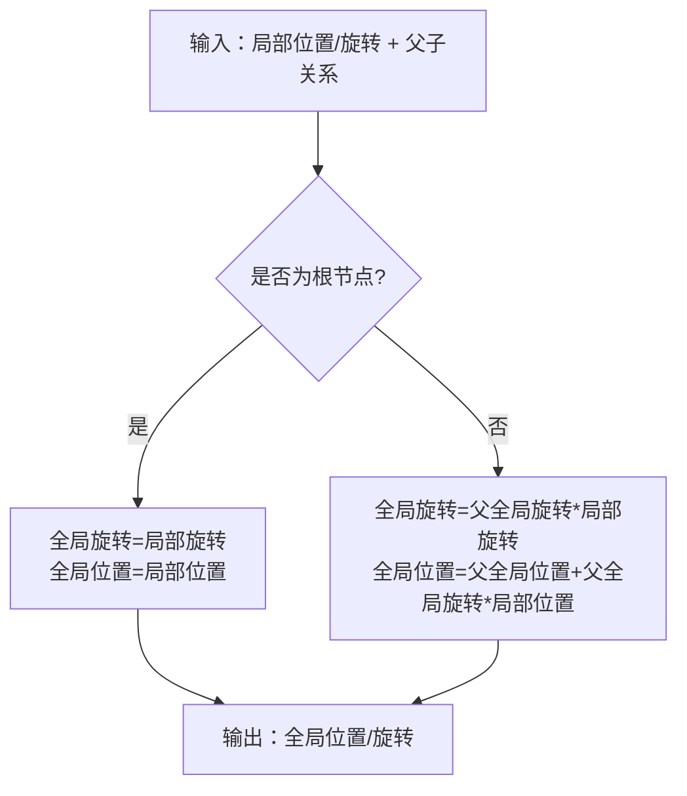
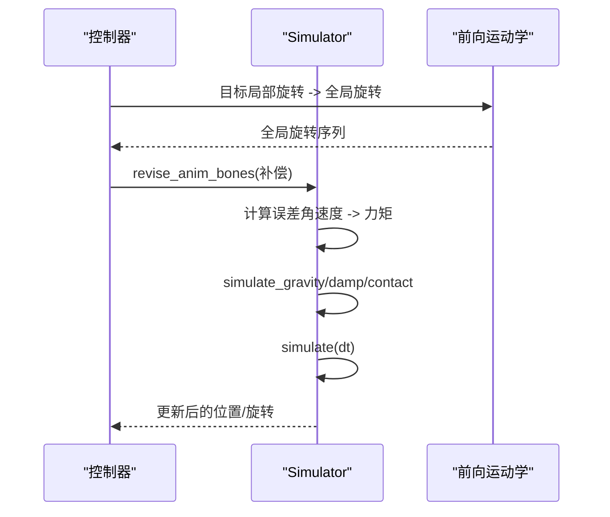
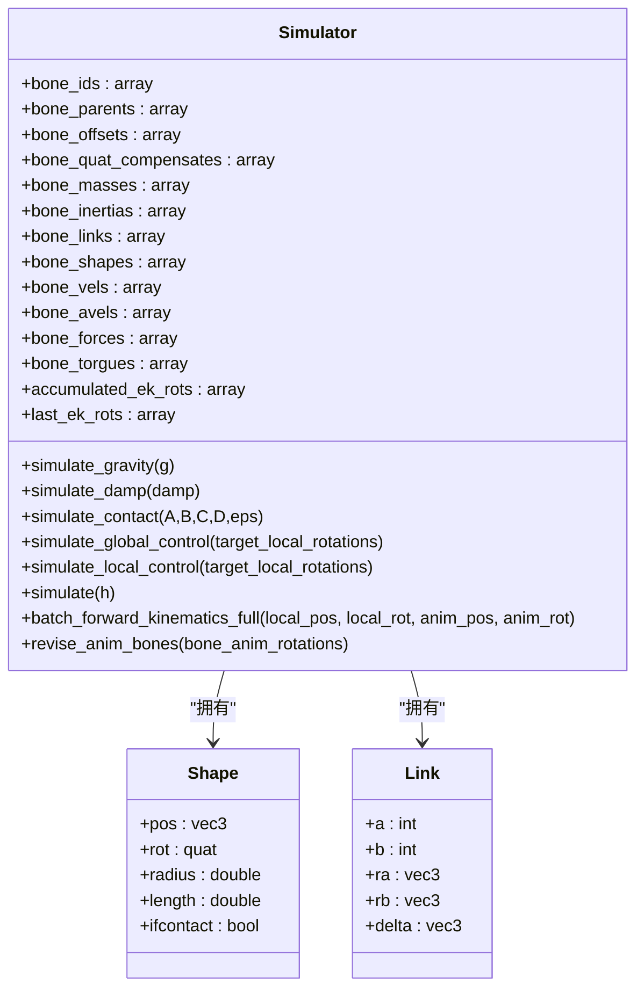
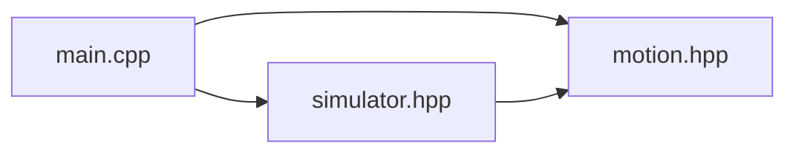
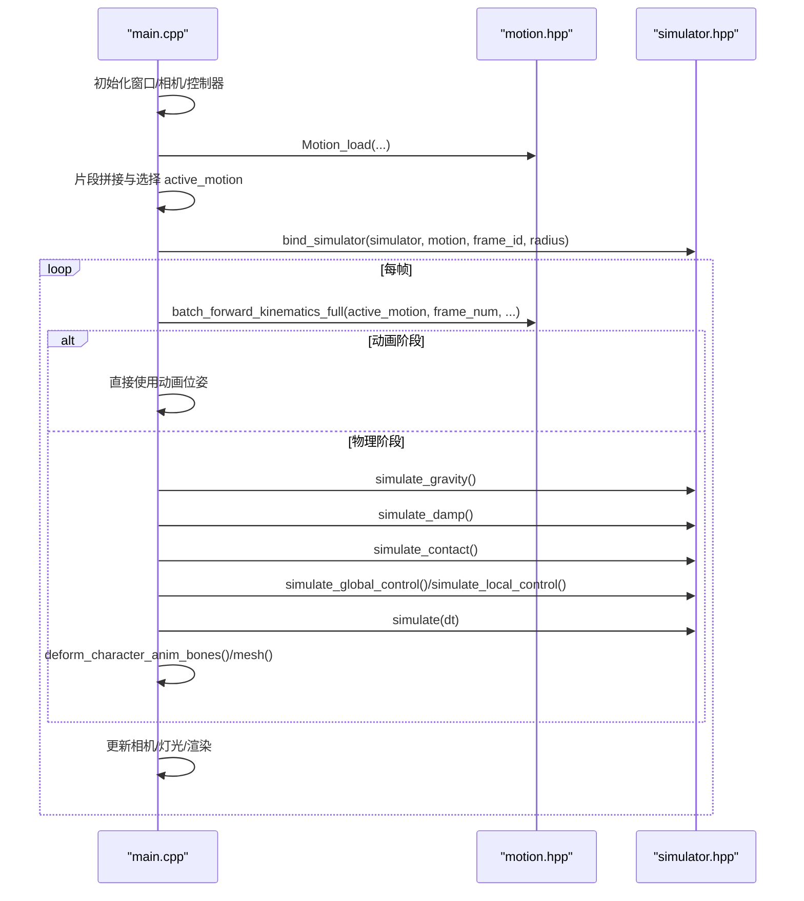

# 物理集成接口

> **版本提示（2.0）**：本文撰写于 1.x 时期，描述的是旧的实现形态——入口在根目录 `main.cpp`，功能由根目录 `.hpp` 头文件库提供，窗口用 raylib、显示用 OpenCV highgui。2.0 已把这些头文件移到 `Source/Legacy/`，渲染默认走 GPU，窗口与 UI 换成 GLFW + ImGui，`main.cpp` 拆成 `Source/Launch/Private/` 下的 `Main.cpp` 与 `Application`。文中的文件路径、行号与调用链可能已失效，请以根目录的「项目概述」「快速开始」「故障排除」三篇与当前源码为准。

<cite>
**本文引用的文件**   
- [README.md](file://README.md)
- [main.cpp](file://main.cpp)
- [simulator.hpp](file://simulator.hpp)
- [motion.hpp](file://motion.hpp)
</cite>

## 目录
1. [简介](#简介)
2. [项目结构](#项目结构)
3. [核心组件](#核心组件)
4. [架构总览](#架构总览)
5. [详细组件分析](#详细组件分析)
6. [依赖关系分析](#依赖关系分析)
7. [性能与稳定性考量](#性能与稳定性考量)
8. [故障排查指南](#故障排查指南)
9. [结论](#结论)
10. [附录：完整集成示例流程](#附录完整集成示例流程)

## 简介
本技术文档聚焦于 MooLab 中“角色动画到物理仿真”的集成接口，重点解释以下能力：
- bind_simulator 的作用：将 BVH 动作数据转换为物理仿真所需的刚体模型（骨骼到刚体的映射、几何参数计算）。
- 前向运动学在物理仿真中的应用：batch_forward_kinematics_full 的实现与使用。
- 物理仿真与动画数据的同步机制：姿态补偿与旋转修正。
- 物理参数调优指南：质量分布、惯性矩阵、碰撞半径等关键参数的设置建议。
- 从动作数据到物理仿真的完整集成流程示例。

本项目基于 C++，使用 raylib 进行渲染与交互，结合自定义的运动学与动力学模块实现角色动画驱动的物理仿真。

**章节来源**
- [README.md:1-22](file://README.md#L1-L22)

## 项目结构
MooLab 的核心代码以头文件与主程序组织，主要涉及：
- motion.hpp：BVH 动作数据结构与批量前向运动学工具函数。
- simulator.hpp：Simulator 类、刚体形状、约束、重力/阻尼/碰撞、控制力矩、时间步进求解器。
- main.cpp：应用入口，加载资源、初始化模拟器、渲染循环、控制器与相机。

**图表来源**
- [main.cpp:53-108](file://main.cpp#L53-L108)
- [motion.hpp:37-70](file://motion.hpp#L37-L70)
- [simulator.hpp:321-355](file://simulator.hpp#L321-L355)

**章节来源**
- [main.cpp:53-108](file://main.cpp#L53-L108)
- [motion.hpp:37-70](file://motion.hpp#L37-L70)
- [simulator.hpp:321-355](file://simulator.hpp#L321-L355)

## 核心组件
- Simulator：封装了刚体形状、质量、惯性、约束、速度/角速度、外力/外力矩、误差累积等状态，并提供重力、阻尼、碰撞检测、局部/全局控制、时间步进求解等方法。
- BVH_Motion：存储骨骼 ID、父子关系、每帧的局部位置与旋转，提供批量前向运动学工具。
- 绑定接口 bind_simulator：将 BVH 动作某一帧的骨架信息映射为物理刚体模型，并初始化物理参数。

关键职责划分：
- 动画侧：BVH_Motion 提供骨骼层级与每帧的局部变换。
- 物理侧：Simulator 维护刚体集合、约束与动力学求解。
- 集成侧：bind_simulator 负责将动画骨架映射为物理刚体，并计算几何与物理参数。

**章节来源**
- [simulator.hpp:321-355](file://simulator.hpp#L321-L355)
- [motion.hpp:37-70](file://motion.hpp#L37-L70)
- [simulator.hpp:664-800](file://simulator.hpp#L664-L800)

## 架构总览
下图展示了从 BVH 动作到物理仿真的整体数据流与调用关系：

**图表来源**
- [main.cpp:96-108](file://main.cpp#L96-L108)
- [simulator.hpp:664-800](file://simulator.hpp#L664-L800)
- [simulator.hpp:357-624](file://simulator.hpp#L357-L624)
- [motion.hpp:122-150](file://motion.hpp#L122-L150)

## 详细组件分析

### bind_simulator：从 BVH 到刚体模型的映射
bind_simulator 的核心任务包括：
- 复制骨骼拓扑：bone_ids、bone_parents。
- 读取初始骨架偏移：bone_offsets = motion.bone_local_positions(frame_id)。
- 分配物理数组：bone_masses、bone_inertias、bone_links、bone_shapes、速度/角速度、外力/外力矩、误差累积等。
- 初始化质量分布：按骨骼索引硬编码质量值。
- 计算当前帧的全局骨架位姿：调用 batch_forward_kinematics_full。
- 根据骨架位姿计算每个刚体的几何参数：
  - 位置 pos：子骨与父骨的中点或特定关节位置。
  - 旋转 rot：父骨全局旋转乘以补偿四元数。
  - 半径 radius：由输入参数或相邻骨骼距离决定。
  - 长度 length：由相邻骨骼距离或固定倍数半径决定。
- 特殊关节处理：对躯干、肩、肘、腕、踝、趾等关节进行差异化几何设定。
- 初始化惯性矩阵：根据质量与形状估算惯性张量。

**图表来源**
- [simulator.hpp:664-800](file://simulator.hpp#L664-L800)

关键点说明：
- 骨骼到刚体的映射并非一一对应：某些骨骼作为连接段生成胶囊体，部分末端关节（如手腕、脚踝）采用球状近似。
- 补偿四元数用于对齐骨骼轴向与胶囊体轴向，确保碰撞与可视化一致。
- 半径 radius 可由外部传入，并在躯干与四肢处做自适应缩放。

**章节来源**
- [simulator.hpp:664-800](file://simulator.hpp#L664-L800)

### 前向运动学在物理仿真中的应用
- motion.hpp 中的 batch_forward_kinematics_full：对给定帧，沿父子链迭代计算全局旋转与位置。
- simulator.hpp 中的 Simulator::batch_forward_kinematics_full：对 Simulator 内部骨架拓扑执行相同逻辑，用于控制阶段的目标姿态计算。

**图表来源**
- [motion.hpp:122-150](file://motion.hpp#L122-L150)
- [simulator.hpp:634-662](file://simulator.hpp#L634-L662)

用途：
- 在绑定阶段，用于计算初始刚体几何。
- 在控制阶段，用于将目标局部旋转转换为全局姿态，再经 revise_anim_bones 补偿后计算误差力矩。

**章节来源**
- [motion.hpp:122-150](file://motion.hpp#L122-L150)
- [simulator.hpp:634-662](file://simulator.hpp#L634-L662)

### 物理仿真与动画数据的同步机制
- 姿态补偿：bone_quat_compensates 保存各骨骼的轴向补偿四元数；revise_anim_bones 在目标旋转上乘以补偿，使控制目标与物理刚体朝向一致。
- 旋转修正：在 simulate_global_control/simulate_local_control 中，通过 quat_to_avel 将目标旋转差转为角速度误差，并结合积分与微分项生成力矩。
- 反馈控制：
  - 全局控制：直接对每个骨骼施加力矩，使其朝向目标全局旋转。
  - 局部控制：考虑接触状态，对根部施加平移力与扭矩，并对其他骨骼施加反作用力矩以保持约束。
- 时间步进：simulate 构建质量矩阵 M、约束雅可比 J、残差 delta，求解线性系统更新速度与角速度，并更新位置与旋转。

**图表来源**
- [simulator.hpp:512-541](file://simulator.hpp#L512-L541)
- [simulator.hpp:437-510](file://simulator.hpp#L437-L510)
- [simulator.hpp:543-624](file://simulator.hpp#L543-L624)

**章节来源**
- [simulator.hpp:512-541](file://simulator.hpp#L512-L541)
- [simulator.hpp:437-510](file://simulator.hpp#L437-L510)
- [simulator.hpp:543-624](file://simulator.hpp#L543-L624)

### 几何参数与物理参数计算
- 几何参数：
  - 位置：父子骨骼中点或关节偏移。
  - 旋转：父骨全局旋转 × 补偿四元数。
  - 半径：由输入 radius 或相邻骨骼距离决定。
  - 长度：由相邻骨骼距离或固定倍数半径决定。
- 物理参数：
  - 质量：按骨骼索引硬编码，体现人体质量分布经验值。
  - 惯性矩阵：根据质量与形状估算，区分不同部位（如手部、手臂、躯干）。
  - 约束：link 定义两刚体间的相对位置约束，用于保持骨架拓扑。

**图表来源**
- [simulator.hpp:302-318](file://simulator.hpp#L302-L318)
- [simulator.hpp:321-355](file://simulator.hpp#L321-L355)

**章节来源**
- [simulator.hpp:302-318](file://simulator.hpp#L302-L318)
- [simulator.hpp:321-355](file://simulator.hpp#L321-L355)

## 依赖关系分析
- main.cpp 依赖 motion.hpp 与 simulator.hpp，负责加载 BVH 动作、初始化 Simulator、渲染循环。
- simulator.hpp 依赖 motion.hpp（包含 BVH_Motion 类型），用于绑定与运动学计算。
- motion.hpp 提供基础数学与运动学工具，供 simulator 与 main 共同使用。

**图表来源**
- [main.cpp:8-17](file://main.cpp#L8-L17)
- [simulator.hpp:4](file://simulator.hpp#L4)

**章节来源**
- [main.cpp:8-17](file://main.cpp#L8-L17)
- [simulator.hpp:4](file://simulator.hpp#L4)

## 性能与稳定性考量
- 前向运动学复杂度：O(N)，N 为骨骼数量，逐层累乘旋转与位移。
- 碰撞检测复杂度：O(M^2)，M 为刚体数量，需优化近邻搜索或空间分割。
- 时间步进求解：构造大型线性系统，使用消元法求解，注意条件数与数值稳定性。
- 控制增益：全局/局部控制的 PD 系数需调参以避免振荡或发散。
- 阻尼与刚度：阻尼过大导致响应迟缓，过小导致不稳定；地面碰撞刚度 kp 与阻尼 kd 需平衡穿透与抖动。

[本节为通用指导，不直接分析具体文件]

## 故障排查指南
常见问题与定位方法：
- 刚体穿透或抖动：
  - 检查 simulate_contact 的地面与刚体间碰撞参数（kp/kd、eps）。
  - 确认 bone_shapes.radius 与 length 是否合理。
- 角色姿态异常：
  - 检查 bone_quat_compensates 是否正确初始化。
  - 确认 revise_anim_bones 是否在控制前调用。
- 质量分布不合理：
  - 核对 bind_simulator 中的质量赋值是否符合预期。
- 惯性矩阵奇异：
  - 检查惯性矩阵初始化逻辑，避免零或极小值。

**章节来源**
- [simulator.hpp:374-435](file://simulator.hpp#L374-L435)
- [simulator.hpp:664-800](file://simulator.hpp#L664-L800)

## 结论
MooLab 的物理集成接口通过 bind_simulator 将 BVH 动作骨架映射为刚体模型，利用批量前向运动学计算全局姿态，并通过控制器与时间步进求解器实现稳定的物理仿真。姿态补偿与旋转修正确保了动画目标与物理刚体的一致性。合理的物理参数调优（质量、惯性、碰撞半径）是获得稳定且自然行为的关键。

[本节为总结性内容，不直接分析具体文件]

## 附录：完整集成示例流程
以下流程展示从动作数据到物理仿真的完整步骤，对应 main.cpp 的实际调用顺序：

1. 初始化窗口与相机、控制器。
2. 加载角色与数据库资源。
3. 加载 BVH 动作数据并进行片段拼接。
4. 创建 Simulator 并调用 bind_simulator 绑定初始帧。
5. 创建胶囊体网格与材质，构建渲染模型。
6. 渲染循环：
   - 计算手柄输入对应的全局/局部速度与角速度。
   - 若处于动画阶段，使用 batch_forward_kinematics_full 获取当前骨架位姿。
   - 若进入物理阶段，依次调用 simulate_gravity、simulate_damp、simulate_contact、simulate_global_control/simulate_local_control、simulate。
   - 将仿真结果回写到骨骼与网格，更新渲染。
   - 更新相机与灯光，绘制场景。

**图表来源**
- [main.cpp:53-108](file://main.cpp#L53-L108)
- [main.cpp:292-345](file://main.cpp#L292-L345)
- [main.cpp:423-472](file://main.cpp#L423-L472)
- [motion.hpp:122-150](file://motion.hpp#L122-L150)
- [simulator.hpp:357-624](file://simulator.hpp#L357-L624)

**章节来源**
- [main.cpp:53-108](file://main.cpp#L53-L108)
- [main.cpp:292-345](file://main.cpp#L292-L345)
- [main.cpp:423-472](file://main.cpp#L423-L472)
- [motion.hpp:122-150](file://motion.hpp#L122-L150)
- [simulator.hpp:357-624](file://simulator.hpp#L357-L624)