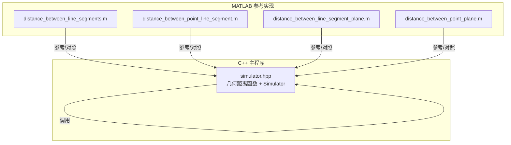
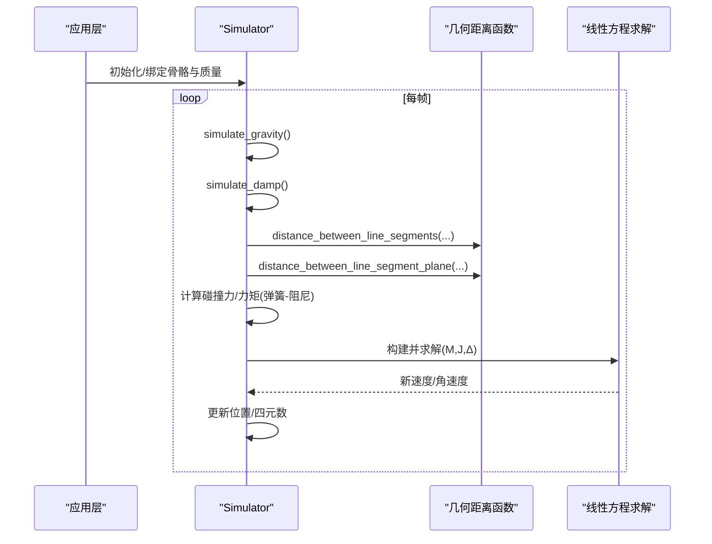
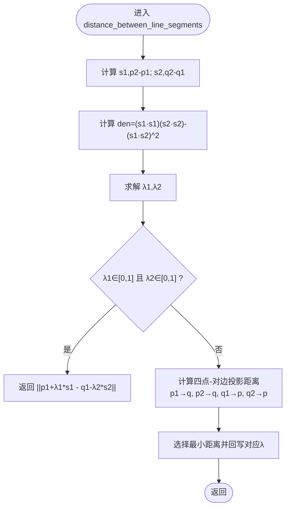
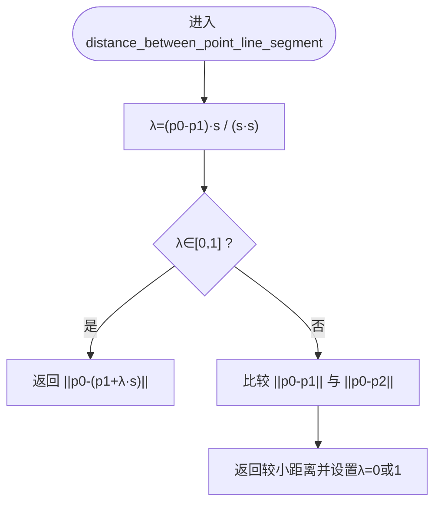
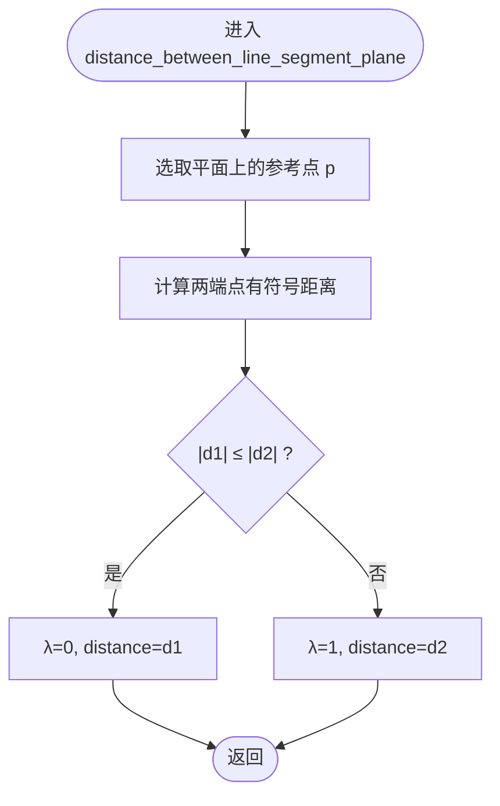
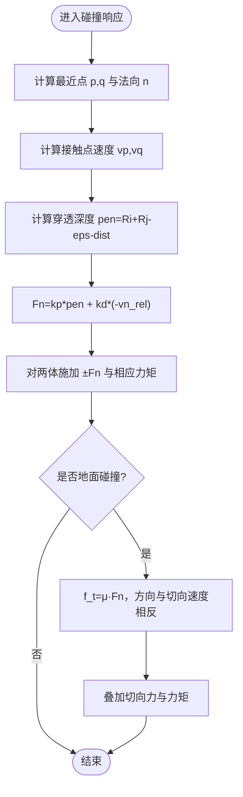

# 碰撞检测系统

> **版本提示（2.0）**：本文撰写于 1.x 时期，描述的是旧的实现形态——入口在根目录 `main.cpp`，功能由根目录 `.hpp` 头文件库提供，窗口用 raylib、显示用 OpenCV highgui。2.0 已把这些头文件移到 `Source/Legacy/`，渲染默认走 GPU，窗口与 UI 换成 GLFW + ImGui，`main.cpp` 拆成 `Source/Launch/Private/` 下的 `Main.cpp` 与 `Application`。文中的文件路径、行号与调用链可能已失效，请以根目录的「项目概述」「快速开始」「故障排除」三篇与当前源码为准。

<cite>
**本文引用的文件**   
- [simulator.hpp](file://simulator.hpp)
- [distance_between_line_segments.m](file://resources/distance_between_line_segments.m)
- [distance_between_point_line_segment.m](file://resources/distance_between_point_line_segment.m)
- [distance_between_line_segment_plane.m](file://resources/distance_between_line_segment_plane.m)
- [distance_between_point_plane.m](file://resources/distance_between_point_plane.m)
- [README.md](file://README.md)
</cite>

## 目录
1. [简介](#简介)
2. [项目结构](#项目结构)
3. [核心组件](#核心组件)
4. [架构总览](#架构总览)
5. [详细组件分析](#详细组件分析)
6. [依赖关系分析](#依赖关系分析)
7. [性能考虑](#性能考虑)
8. [故障排查指南](#故障排查指南)
9. [结论](#结论)

## 简介
本技术文档聚焦于 MooLab 的碰撞检测与响应子系统，重点解释以下方面：
- 线段与线段的距离计算（含数学原理与几何推导）
- 点与线段的距离计算（投影与边界处理）
- 平面碰撞检测（法向量、距离判断与地面接触）
- 碰撞响应的力计算（弹簧-阻尼模型参数 kp、kd 调优）
- 性能优化策略（空间分割与层次包围盒概念）
- 实际碰撞场景示例（不同几何形状之间的检测与响应）

MooLab 是一个角色运动渲染与仿真器，其物理仿真与碰撞逻辑集中在模拟器中实现。

**章节来源**
- [README.md:1-22](file://README.md#L1-L22)

## 项目结构
与碰撞检测直接相关的代码主要位于 C++ 头文件中，同时提供 MATLAB 参考实现用于验证与教学。关键文件如下：
- simulator.hpp：C++ 实现的几何距离函数、Simulator 类及其碰撞检测与响应流程
- resources/*.m：MATLAB 参考实现，包含线段-线段、点-线段、线段-平面、点-平面的距离计算



**图表来源**
- [simulator.hpp:191-300](file://simulator.hpp#L191-L300)
- [distance_between_line_segments.m:1-32](file://resources/distance_between_line_segments.m#L1-L32)
- [distance_between_point_line_segment.m:1-18](file://resources/distance_between_point_line_segment.m#L1-L18)
- [distance_between_line_segment_plane.m:1-22](file://resources/distance_between_line_segment_plane.m#L1-L22)
- [distance_between_point_plane.m:1-3](file://resources/distance_between_point_plane.m#L1-L3)

**章节来源**
- [simulator.hpp:191-300](file://simulator.hpp#L191-L300)
- [distance_between_line_segments.m:1-32](file://resources/distance_between_line_segments.m#L1-L32)
- [distance_between_point_line_segment.m:1-18](file://resources/distance_between_point_line_segment.m#L1-L18)
- [distance_between_line_segment_plane.m:1-22](file://resources/distance_between_line_segment_plane.m#L1-L22)
- [distance_between_point_plane.m:1-3](file://resources/distance_between_point_plane.m#L1-L3)

## 核心组件
- 几何距离工具函数
  - 点-平面距离
  - 线段-平面距离
  - 点-线段距离
  - 线段-线段距离
- 物理实体表示
  - shape：每个骨骼段用圆柱近似（位置、旋转、半径、长度）
  - link：关节约束
- 仿真器
  - Simulator：负责重力、阻尼、碰撞检测与响应、动力学求解与控制

这些组件共同构成“检测-响应-积分”的闭环。

**章节来源**
- [simulator.hpp:191-300](file://simulator.hpp#L191-L300)
- [simulator.hpp:311-355](file://simulator.hpp#L311-L355)
- [simulator.hpp:357-435](file://simulator.hpp#L357-L435)

## 架构总览
下图展示了从输入到输出的整体数据流：骨骼姿态驱动形心与方向，生成各段圆柱；在每帧中执行重力、阻尼、碰撞检测与响应，最后通过线性方程组求解速度并更新位姿。



**图表来源**
- [simulator.hpp:357-435](file://simulator.hpp#L357-L435)
- [simulator.hpp:543-624](file://simulator.hpp#L543-L624)

**章节来源**
- [simulator.hpp:357-435](file://simulator.hpp#L357-L435)
- [simulator.hpp:543-624](file://simulator.hpp#L543-L624)

## 详细组件分析

### 线段与线段的距离（distance_between_line_segments）
- 数学原理
  - 将两条线段分别表示为 p(t)=p1+t·s1 与 q(u)=q1+u·s2，其中 s1=p2-p1，s2=q2-q1。
  - 最小化 ||p(t)-q(u)||^2 得到关于 t,u 的线性方程组，解出 t=λ1，u=λ2。
  - 若 λ1∈[0,1] 且 λ2∈[0,1]，则最短距离即为两线段内部最近点对的距离。
  - 否则退化为点到线段的距离问题，比较四个候选距离（p1/p2 到线段 q，以及 q1/q2 到线段 p），取最小值。
- 数值稳定性
  - 分母 den = (s1·s1)(s2·s2)-(s1·s2)^2，接近零时视为平行或退化情况，使用阈值保护避免除零。
- 复杂度
  - O(1) 基本运算，常数时间。



**图表来源**
- [simulator.hpp:256-300](file://simulator.hpp#L256-L300)
- [distance_between_line_segments.m:1-32](file://resources/distance_between_line_segments.m#L1-L32)

**章节来源**
- [simulator.hpp:256-300](file://simulator.hpp#L256-L300)
- [distance_between_line_segments.m:1-32](file://resources/distance_between_line_segments.m#L1-L32)

### 点与线段的距离（distance_between_point_line_segment）
- 算法要点
  - 将点 p0 投影到直线 p1+p·s 上，求标量 p=λ。
  - 若 λ∈[0,1]，最近点在线段内部，距离为 ||p0-(p1+λ·s)||。
  - 否则最近点为端点之一，比较 p0 到 p1 与 p0 到 p2 的距离，取较小者。
- 边界处理
  - 当线段长度接近零（den≈0）时，直接退化为点到点的距离。
- 复杂度
  - O(1)。



**图表来源**
- [simulator.hpp:229-254](file://simulator.hpp#L229-L254)
- [distance_between_point_line_segment.m:1-18](file://resources/distance_between_point_line_segment.m#L1-L18)

**章节来源**
- [simulator.hpp:229-254](file://simulator.hpp#L229-L254)
- [distance_between_point_line_segment.m:1-18](file://resources/distance_between_point_line_segment.m#L1-L18)

### 平面碰撞检测（线段-平面、点-平面）
- 点-平面距离
  - 给定平面 Ax+By+Cz+D=0，点 p 的距离为 |Ap+Bp+Cp+D|/√(A²+B²+C²)。
- 线段-平面距离
  - 先选取平面上一个参考点 p（根据 A/B/C 非零分量构造）。
  - 计算两端点相对于法向量的有符号距离，再乘以点-平面距离得到带符号距离。
  - 取两端点中带符号距离绝对值较小的作为线段到平面的距离，并记录对应的 λ（0 或 1）。
- 地面碰撞
  - 在 Simulator::simulate_contact 中，对每个骨骼段的两端点构成的线段与地面平面做检测。
  - 若距离小于半径-容差，判定为接触，计算法向力与切向摩擦力。



**图表来源**
- [simulator.hpp:191-227](file://simulator.hpp#L191-L227)
- [distance_between_line_segment_plane.m:1-22](file://resources/distance_between_line_segment_plane.m#L1-L22)
- [distance_between_point_plane.m:1-3](file://resources/distance_between_point_plane.m#L1-L3)

**章节来源**
- [simulator.hpp:191-227](file://simulator.hpp#L191-L227)
- [distance_between_line_segment_plane.m:1-22](file://resources/distance_between_line_segment_plane.m#L1-L22)
- [distance_between_point_plane.m:1-3](file://resources/distance_between_point_plane.m#L1-L3)

### 碰撞响应的力计算（弹簧-阻尼模型）
- 刚体-刚体碰撞
  - 最近点 p∈线段 i，q∈线段 j，法向 n=(p-q)/||p-q||。
  - 计算接触点处线速度 vp、vq（含平移与旋转贡献）。
  - 法向相对速度 vn_rel = (vp-vq)·n。
  - 法向力 Fn = kp·penetration + kd·(-vn_rel)，其中 penetration = R_i+R_j-eps-distance。
  - 对两个物体施加大小相等、方向相反的力与力矩。
- 地面碰撞
  - 法向为平面法向量 n=(A,B,C)/||(A,B,C)||。
  - 法向力 Fn = kp·penetration + kd·(-vn)，仅当物体朝向平面运动时生效。
  - 切向摩擦力 f_t = μ·Fn，方向沿切向速度反方向（μ=0.6）。
- 参数说明
  - kp：刚度系数，控制穿透恢复强度；kd：阻尼系数，抑制振荡。
  - 代码中针对不同场景设置了不同的默认值（例如刚体-刚体与地面碰撞的 kd 不同）。



**图表来源**
- [simulator.hpp:374-435](file://simulator.hpp#L374-L435)

**章节来源**
- [simulator.hpp:374-435](file://simulator.hpp#L374-L435)

### 数据结构与类图
```mermaid
classDiagram
class Simulator {
+array1d<int> bone_ids
+array1d<int> bone_parents
+array1d<double> bone_masses
+array1d<mat3> bone_inertias
+array1d<link> bone_links
+array1d<shape> bone_shapes
+array1d<vec3> bone_vels
+array1d<vec3> bone_avels
+array1d<vec3> bone_forces
+array1d<vec3> bone_torgues
+simulate_gravity(g)
+simulate_damp(damp)
+simulate_contact(A,B,C,D,eps)
+simulate(dt)
}
class shape {
+vec3 pos
+quat rot
+double radius
+double length
+bool ifcontact
}
class link {
+int a
+int b
+vec3 ra
+vec3 rb
+vec3 delta
}
Simulator --> shape : "管理多个"
Simulator --> link : "管理多个"
```

**图表来源**
- [simulator.hpp:302-355](file://simulator.hpp#L302-L355)

**章节来源**
- [simulator.hpp:302-355](file://simulator.hpp#L302-L355)

## 依赖关系分析
- 模块内聚性
  - 几何距离函数集中定义，被 Simulator::simulate_contact 复用，耦合度低。
- 外部依赖
  - 依赖基础数学库（向量、矩阵、四元数等），但具体实现不在本仓库范围内。
- 潜在循环依赖
  - 当前几何函数不反向依赖 Simulator，无循环依赖迹象。


**图表来源**
- [simulator.hpp:191-300](file://simulator.hpp#L191-L300)
- [simulator.hpp:374-435](file://simulator.hpp#L374-L435)
- [simulator.hpp:543-624](file://simulator.hpp#L543-L624)

**章节来源**
- [simulator.hpp:191-300](file://simulator.hpp#L191-L300)
- [simulator.hpp:374-435](file://simulator.hpp#L374-L435)
- [simulator.hpp:543-624](file://simulator.hpp#L543-L624)

## 性能考虑
- 当前实现
  - 刚体-刚体碰撞采用 O(N^2) 的全量配对检查，N 为骨骼段数量。
  - 地面碰撞为 O(N)。
- 优化建议
  - 空间分割：引入网格或八叉树，按体素/子空间组织对象，减少无效配对。
  - 层次包围盒（AABB/OBB）：为每个骨骼段维护 AABB/OBB，先进行粗检，再进行精确线段-线段检测。
  - 增量更新：仅在位移超过阈值的对象间进行检测。
  - 并行化：对独立对象对的检测与响应进行并行化（OpenMP 已用于矩阵乘法）。
  - 预筛选：基于质心距离或高度范围快速剔除不可能碰撞的对。

[本节为通用指导，不直接分析具体文件]

## 故障排查指南
- 数值不稳定
  - 现象：den 接近零导致除零或异常大值。
  - 处理：确保使用阈值保护（代码中已使用 max(den, ε) 或 std::max(den, 1e-8)）。
- 穿透过大或抖动
  - 现象：kp 过小导致穿透严重；kd 过小导致反弹振荡。
  - 处理：适当增大 kp 以抑制穿透，调整 kd 以抑制振荡；对不同接触面（刚体-刚体 vs 地面）分别调参。
- 摩擦异常
  - 现象：切向力过大或过小。
  - 处理：调整摩擦系数 μ（代码中使用 0.6），并结合 kd 稳定接触。
- 性能瓶颈
  - 现象：N 较大时帧率下降。
  - 处理：引入空间分割与层次包围盒，减少 O(N^2) 配对次数。

**章节来源**
- [simulator.hpp:256-300](file://simulator.hpp#L256-L300)
- [simulator.hpp:374-435](file://simulator.hpp#L374-L435)

## 结论
MooLab 的碰撞检测系统以简洁而稳健的几何原语为基础，实现了线段-线段、点-线段、线段-平面与点-平面的距离计算，并在 Simulator 中完成刚体-刚体与地面的碰撞检测与响应。弹簧-阻尼模型提供了可控的接触力，配合合理的 kp/kd 参数可在稳定性与真实性之间取得平衡。对于大规模场景，建议引入空间分割与层次包围盒以提升性能。

[本节为总结性内容，不直接分析具体文件]