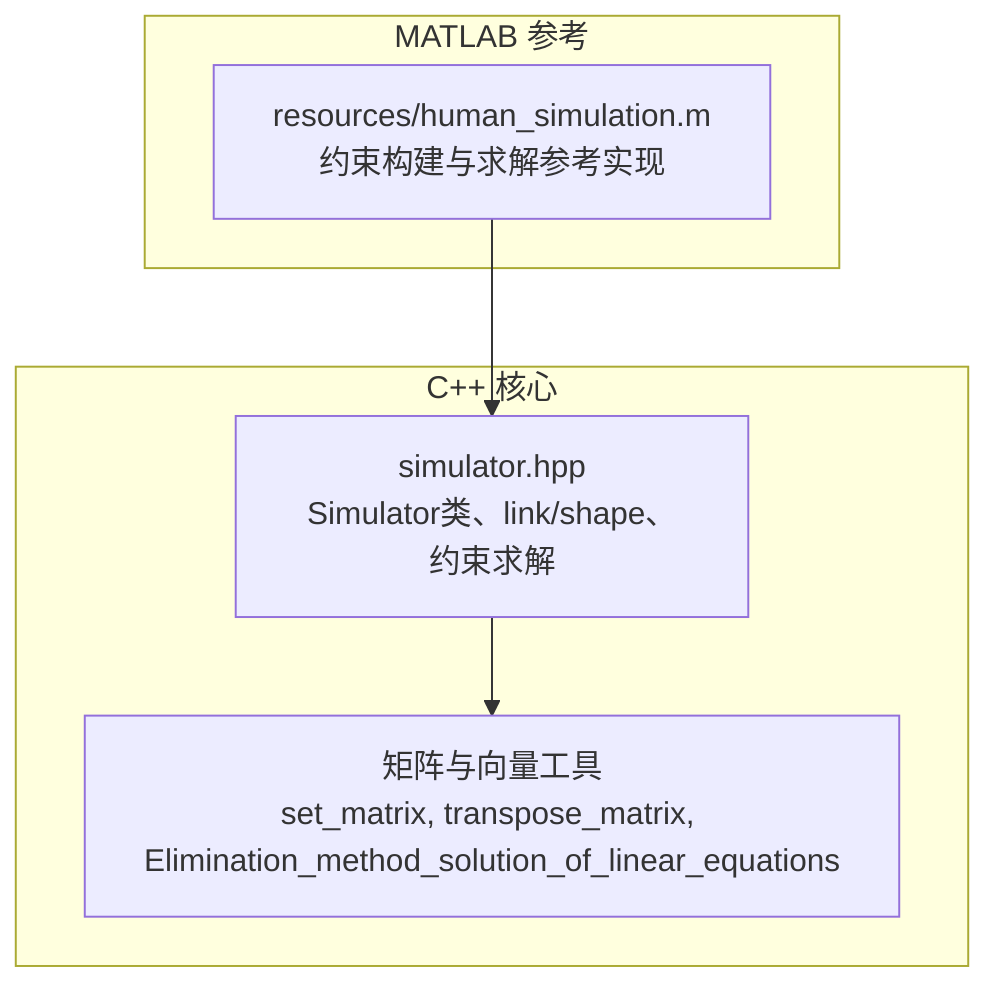
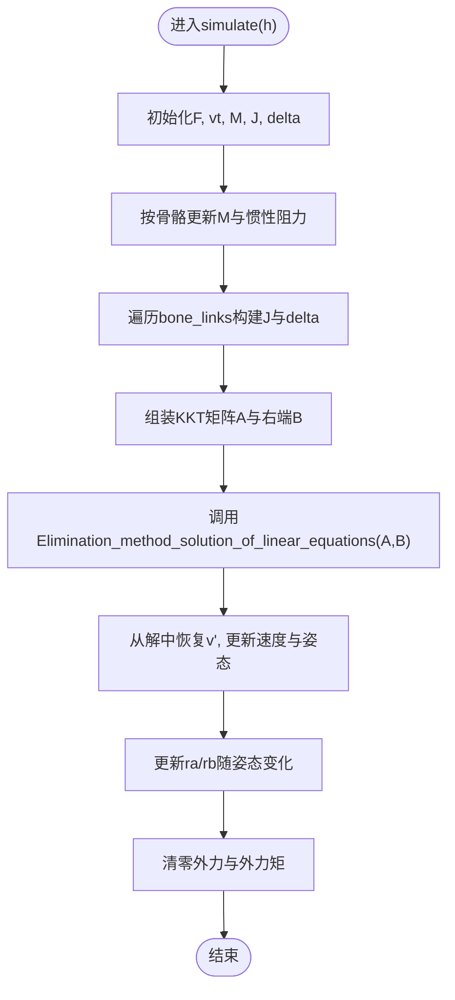
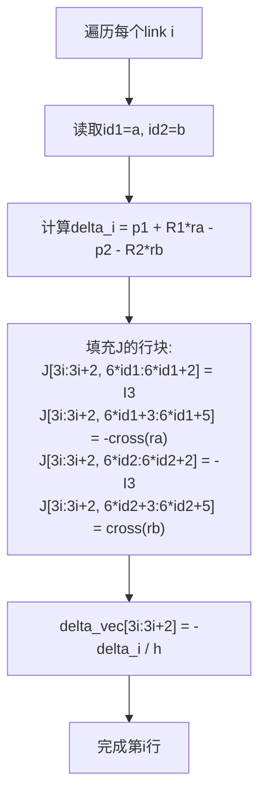
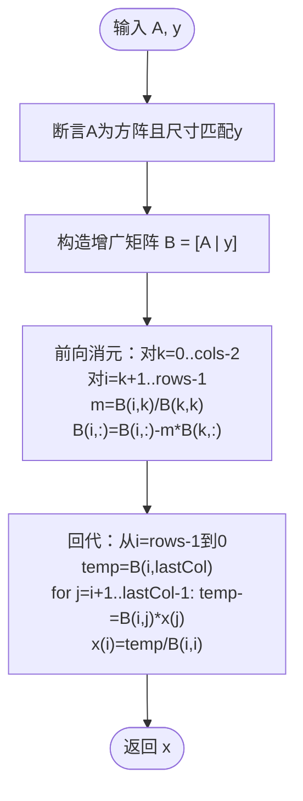
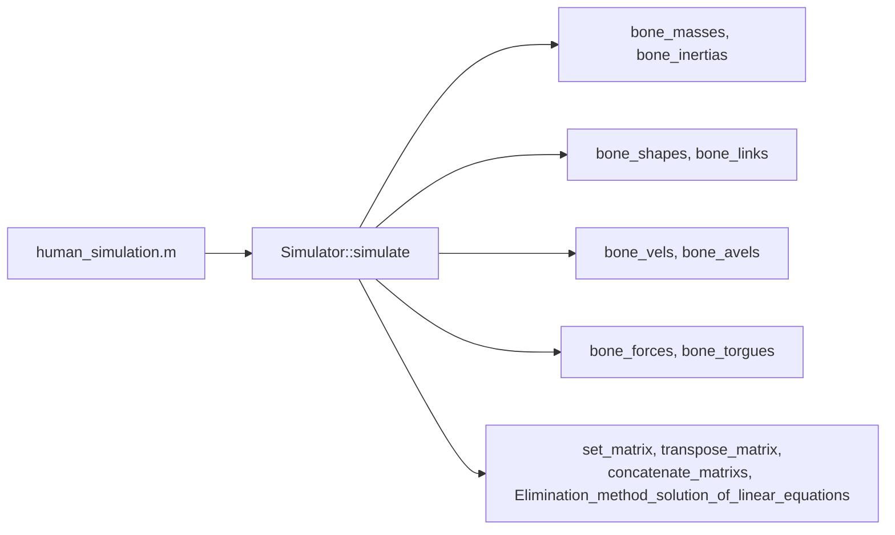

# 约束求解系统

> **版本提示（2.0）**：本文撰写于 1.x 时期，描述的是旧的实现形态——入口在根目录 `main.cpp`，功能由根目录 `.hpp` 头文件库提供，窗口用 raylib、显示用 OpenCV highgui。2.0 已把这些头文件移到 `Source/Legacy/`，渲染默认走 GPU，窗口与 UI 换成 GLFW + ImGui，`main.cpp` 拆成 `Source/Launch/Private/` 下的 `Main.cpp` 与 `Application`。文中的文件路径、行号与调用链可能已失效，请以根目录的「项目概述」「快速开始」「故障排除」三篇与当前源码为准。

<cite>
**本文引用的文件**   
- [simulator.hpp](file://simulator.hpp)
- [human_simulation.m](file://resources/human_simulation.m)
</cite>

## 目录
1. [引言](#引言)
2. [项目结构](#项目结构)
3. [核心组件](#核心组件)
4. [架构总览](#架构总览)
5. [详细组件分析](#详细组件分析)
6. [依赖关系分析](#依赖关系分析)
7. [性能与数值稳定性](#性能与数值稳定性)
8. [故障排查指南](#故障排查指南)
9. [结论](#结论)
10. [附录：约束配置示例](#附录约束配置示例)

## 引言
本技术文档聚焦于MooLab中的约束求解子系统，围绕以下目标展开：
- 解释link结构体的设计，包括骨骼连接点的定义与约束关系的表示。
- 详细说明约束方程的构建过程，包括Jacobian矩阵的计算与约束误差delta的求解。
- 解释线性方程组的求解方法，特别是Elimination_method_solution_of_linear_equations的实现原理。
- 说明约束力的计算与施加过程，包括拉格朗日乘数法的应用。
- 提供约束系统的稳定性分析，包括数值稳定性和收敛性考虑。
- 给出具体约束配置示例，展示如何为不同骨骼结构设置合适的约束参数。

## 项目结构
本项目在C++侧通过头文件组织核心仿真逻辑，MATLAB脚本用于参考实现与对比验证。关键文件如下：
- simulator.hpp：包含矩阵运算、几何工具、Simulator类、约束求解主流程以及link/shape等数据结构。
- resources/human_simulation.m：MATLAB参考实现，复现了相同的约束构建与求解流程，便于对照理解。



图表来源
- [simulator.hpp:154-189](file://simulator.hpp#L154-L189)
- [simulator.hpp:302-309](file://simulator.hpp#L302-L309)
- [simulator.hpp:543-624](file://simulator.hpp#L543-L624)
- [human_simulation.m:211-231](file://resources/human_simulation.m#L211-L231)

章节来源
- [simulator.hpp:1-10](file://simulator.hpp#L1-L10)
- [human_simulation.m:1-10](file://resources/human_simulation.m#L1-L10)

## 核心组件
- link结构体：描述两个骨骼节点之间的约束关系，包含两端骨骼索引、局部偏移ra/rb以及约束误差delta。
- shape结构体：描述每个骨骼的几何与接触状态（位置、姿态、半径、长度、是否接触）。
- Simulator类：封装骨骼动力学与约束求解的主循环，负责组装质量矩阵M、Jacobian矩阵J、约束误差delta，并调用线性方程求解器得到速度增量和约束力。

章节来源
- [simulator.hpp:302-309](file://simulator.hpp#L302-L309)
- [simulator.hpp:311-318](file://simulator.hpp#L311-L318)
- [simulator.hpp:321-355](file://simulator.hpp#L321-L355)

## 架构总览
约束求解采用基于拉格朗日乘数的隐式积分框架，将动力学方程与约束方程组合成KKT型线性系统：
- 动力学部分：M * v' = M * v + F - J^T * lambda
- 约束部分：J * v' = delta
其中：
- M为块对角质量矩阵（平移与旋转惯量）
- J为约束Jacobian
- delta为约束误差项（与时间步h相关）
- lambda为拉格朗日乘子（即约束力）



图表来源
- [simulator.hpp:543-624](file://simulator.hpp#L543-L624)

章节来源
- [simulator.hpp:543-624](file://simulator.hpp#L543-L624)

## 详细组件分析

### link结构体设计与约束关系
- a, b：约束两端的骨骼索引（id1=id1, id2=b）。
- ra, rb：在各自骨骼坐标系下的局部偏移向量，表示约束点在骨骼上的相对位置。
- delta：当前帧的约束误差向量，定义为“p1 + R1*ra - p2 - R2*rb”，衡量两端约束点在世界坐标下的偏差。

该结构体配合Simulator::bone_links数组，形成完整的约束图。每个link对应一个三维约束方程，因此J的行数为3*num_links。

```mermaid
classDiagram
class link {
+int a
+int b
+vec3 ra
+vec3 rb
+vec3 delta
}
class shape {
+vec3 pos
+quat rot
+double radius
+double length
+bool ifcontact
}
class Simulator {
+array1d<int> bone_ids
+array1d<int> bone_parents
+array1d<vec3> bone_offsets
+array1d<quat> bone_quat_compensates
+array1d<double> bone_masses
+array1d<mat3> bone_inertias
+array1d<link> bone_links
+array1d<shape> bone_shapes
+array1d<vec3> bone_vels
+array1d<vec3> bone_avels
+array1d<vec3> bone_forces
+array1d<vec3> bone_torgues
+void simulate(double h)
}
Simulator --> link : "使用"
Simulator --> shape : "使用"
```

图表来源
- [simulator.hpp:302-309](file://simulator.hpp#L302-L309)
- [simulator.hpp:311-318](file://simulator.hpp#L311-L318)
- [simulator.hpp:321-355](file://simulator.hpp#L321-L355)

章节来源
- [simulator.hpp:302-309](file://simulator.hpp#L302-L309)
- [simulator.hpp:311-318](file://simulator.hpp#L311-L318)
- [simulator.hpp:321-355](file://simulator.hpp#L321-L355)

### Jacobian矩阵与约束误差delta的构建
对每个link(i)，设id1=a, id2=b：
- 约束误差：delta_i = (pos_id1 + R_id1*ra_i) - (pos_id2 + R_id2*rb_i)
- Jacobian行块J_i对(id1)的平移自由度为+I_3，对(id1)的角动量自由度为-cross(ra_i)，对(id2)的平移自由度为-I_3，对(id2)的角动量自由度为+cross(rb_i)。
- 右端项delta_vec = -delta_i / h，体现隐式积分的时间离散化。



图表来源
- [simulator.hpp:572-584](file://simulator.hpp#L572-L584)
- [human_simulation.m:211-223](file://resources/human_simulation.m#L211-L223)

章节来源
- [simulator.hpp:572-584](file://simulator.hpp#L572-L584)
- [human_simulation.m:211-223](file://resources/human_simulation.m#L211-L223)

### 线性方程组求解：Elimination_method_solution_of_linear_equations
该函数实现高斯消元与回代求解Ax=y：
- 输入A为方阵，y为列向量。
- 构造增广矩阵B=[A|y]。
- 前向消元：对每一列k，用主元B(k,k)消去下方元素。
- 回代：从最后一行开始求解x。

注意：该实现未进行选主元（partial pivoting），在病态或奇异情况下可能不稳定。



图表来源
- [simulator.hpp:154-189](file://simulator.hpp#L154-L189)

章节来源
- [simulator.hpp:154-189](file://simulator.hpp#L154-L189)

### 拉格朗日乘数法与约束力的计算与施加
- KKT系统：
  [ M   -J^T ] [ v' ] = [ M*v + F ]
  [ J    0   ] [ lambda] = [ delta   ]
- 求解后：
  - v'为下一时刻的速度（平移与角速度）。
  - lambda为约束力（拉格朗日乘子），可通过lambda = J*(v') - delta反推，或直接由求解结果的后半段获得（取决于求解器的输出布局）。
- 约束力对动力学的影响体现在M*v' = M*v + F - J^T*lambda，即约束力以-J^T*lambda的形式作用于各自由度的运动方程。

```mermaid
sequenceDiagram
participant Sim as "Simulator : : simulate"
participant Mat as "矩阵装配"
participant Solver as "Elimination_method_solution_of_linear_equations"
Sim->>Mat : 组装A=[M,-J^T; J,0], B=[M*v+F; delta]
Mat-->>Sim : A, B
Sim->>Solver : 求解(A,B)
Solver-->>Sim : vt_1 = [v'; lambda]
Sim->>Sim : 更新v', 姿态, ra/rb
Note over Sim : 约束力lambda通过-J^T*lambda影响动力学
```

图表来源
- [simulator.hpp:585-600](file://simulator.hpp#L585-L600)
- [simulator.hpp:600-624](file://simulator.hpp#L600-L624)

章节来源
- [simulator.hpp:585-624](file://simulator.hpp#L585-L624)

## 依赖关系分析
- Simulator::simulate依赖：
  - 质量与惯量：bone_masses, bone_inertias
  - 几何与约束：bone_shapes, bone_links
  - 运动学：bone_vels, bone_avels
  - 外部作用：bone_forces, bone_torgues
- 数学工具依赖：
  - set_matrix, transpose_matrix, concatenate_matrixs
  - vec_to_cross_matrix, quat_to_Rodrigues, trans_mat等（在其它头文件中定义）
- MATLAB参考实现human_simulation.m与C++实现保持一致的约束构建与求解流程，便于交叉验证。



图表来源
- [simulator.hpp:543-624](file://simulator.hpp#L543-L624)
- [human_simulation.m:198-231](file://resources/human_simulation.m#L198-L231)

章节来源
- [simulator.hpp:543-624](file://simulator.hpp#L543-L624)
- [human_simulation.m:198-231](file://resources/human_simulation.m#L198-L231)

## 性能与数值稳定性
- 复杂度：
  - 装配A矩阵O((N+3L)^2)，求解O((N+3L)^3)，其中N为自由度总数（平移+旋转），L为约束数量。
- 数值稳定性：
  - Elimination_method_solution_of_linear_equations未做选主元，当A接近奇异或条件数较大时可能出现数值不稳定。
  - 建议引入部分选主元（partial pivoting）或改用更稳定的分解（如LU分解带选主元、SVD正则化）。
- 收敛性与稳定性：
  - 隐式欧拉结合KKT系统通常具备更好的稳定性，但受限于时间步长h与约束刚度。
  - 对于强约束（如刚体连接），可考虑增加阻尼或正则化项以提升条件数。
- 并行优化：
  - 矩阵乘法已使用OpenMP并行化，可进一步对装配J与delta的过程进行并行化。

章节来源
- [simulator.hpp:154-189](file://simulator.hpp#L154-L189)
- [simulator.hpp:61-79](file://simulator.hpp#L61-L79)

## 故障排查指南
- 约束不收敛或抖动：
  - 检查delta是否过大；适当减小时间步h或增大约束刚度。
  - 检查J是否奇异或接近奇异；调整ra/rb避免共线或退化构型。
- 求解失败或NaN：
  - 检查A是否非方阵或尺寸不匹配；确认bone_links与bone_shapes维度一致。
  - 检查Elimination_method_solution_of_linear_equations的主元是否为0；必要时加入选主元。
- 物理异常（穿透、爆炸）：
  - 检查碰撞检测与接触力参数kp/kd是否合理。
  - 检查重力、阻尼与外部力矩是否被正确累加。

章节来源
- [simulator.hpp:374-435](file://simulator.hpp#L374-L435)
- [simulator.hpp:154-189](file://simulator.hpp#L154-L189)

## 结论
MooLab的约束求解系统通过KKT线性系统统一处理动力学与约束，link结构体清晰表达骨骼间的约束关系，Jacobian与delta的构建遵循标准公式，求解器采用高斯消元实现。为保证数值稳定与收敛，建议在求解器中加入选主元，并根据场景调节时间步与约束刚度。MATLAB参考实现与C++实现保持一致，便于验证与扩展。

## 附录：约束配置示例
以下为不同骨骼结构的约束配置思路与步骤（概念性指导，不直接粘贴代码）：
- 单根连杆（肩-肘-腕）：
  - 定义link(shoulder, elbow)与link(elbow, wrist)。
  - ra设为肩部关节到肘部的局部偏移，rb设为肘部关节到腕部的局部偏移。
  - 初始姿态下确保ra与rb方向合理，避免共线。
- 双臂对称结构：
  - 左右臂分别定义三根link，保持ra/rb对称。
  - 质量与惯量按肢体长度与密度估算，保证M的条件数良好。
- 躯干与骨盆：
  - 使用多根link连接脊柱节段，ra/rb沿脊柱切线方向。
  - 可增加阻尼项提高稳定性。
- 参数调优建议：
  - 时间步h：从0.016~0.033秒起步，逐步减小直至约束误差delta收敛。
  - 约束刚度：若出现穿透，可适当增大kp（接触刚度）或在约束方程中引入正则化。
  - 阻尼：适当增加全局阻尼以抑制高频振荡。

章节来源
- [simulator.hpp:543-624](file://simulator.hpp#L543-L624)
- [human_simulation.m:15-39](file://resources/human_simulation.m#L15-L39)