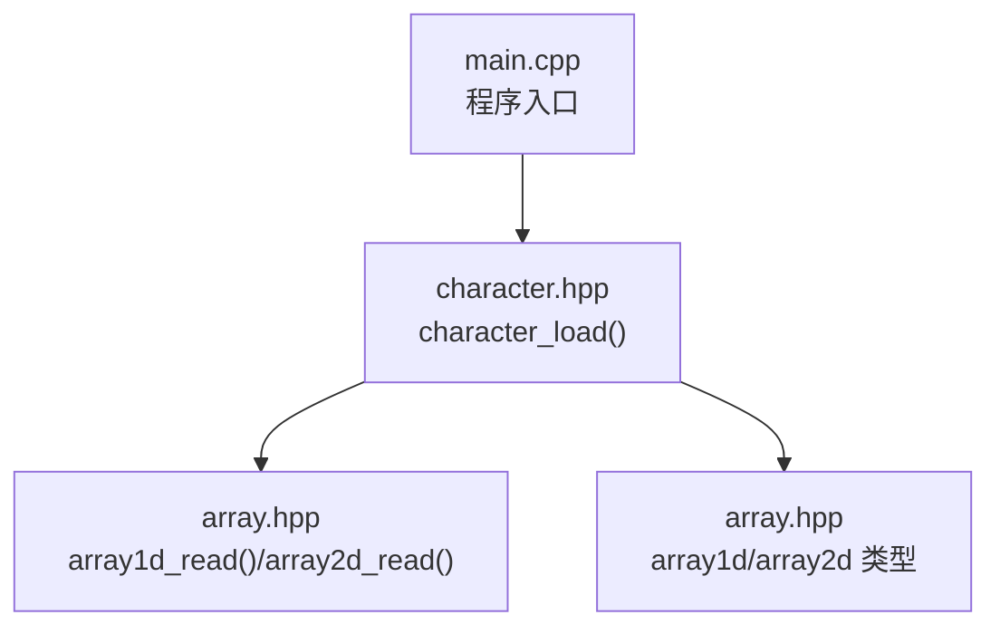
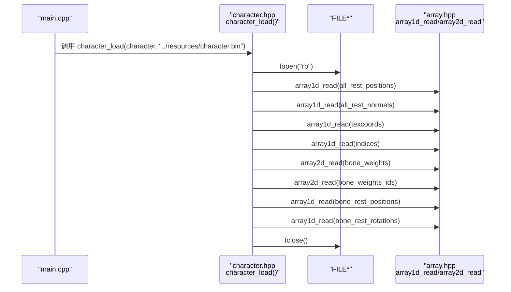
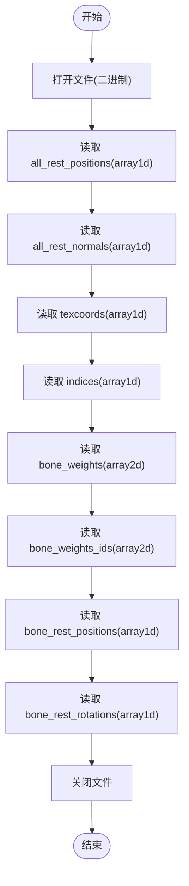
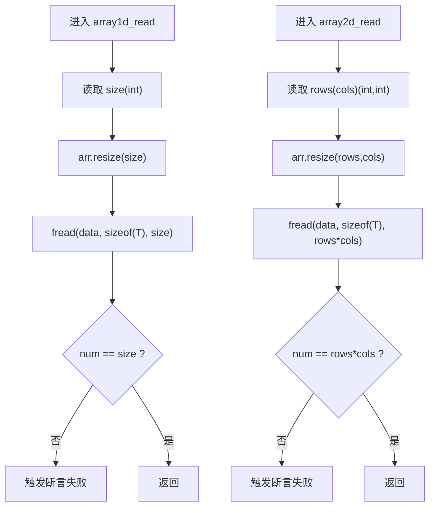

# 数据加载

> **版本提示（2.0）**：本文撰写于 1.x 时期，描述的是旧的实现形态——入口在根目录 `main.cpp`，功能由根目录 `.hpp` 头文件库提供，窗口用 raylib、显示用 OpenCV highgui。2.0 已把这些头文件移到 `Source/Legacy/`，渲染默认走 GPU，窗口与 UI 换成 GLFW + ImGui，`main.cpp` 拆成 `Source/Launch/Private/` 下的 `Main.cpp` 与 `Application`。文中的文件路径、行号与调用链可能已失效，请以根目录的「项目概述」「快速开始」「故障排除」三篇与当前源码为准。

<cite>
**本文引用的文件**   
- [character.hpp](file://character.hpp)
- [array.hpp](file://array.hpp)
- [main.cpp](file://main.cpp)
</cite>

## 目录
1. [简介](#简介)
2. [项目结构](#项目结构)
3. [核心组件](#核心组件)
4. [架构总览](#架构总览)
5. [详细组件分析](#详细组件分析)
6. [依赖关系分析](#依赖关系分析)
7. [性能考量](#性能考量)
8. [故障排查指南](#故障排查指南)
9. [结论](#结论)
10. [附录：自定义格式扩展与示例](#附录自定义格式扩展与示例)

## 简介
本文档聚焦于MooLab中角色数据的二进制加载机制，重点解析 character_load 函数如何按固定顺序读取二进制文件中的向量、矩阵与数组数据；说明 array1d_read 与 array2d_read 模板函数的实现原理；梳理文件IO的错误处理与断言检查；并提供扩展自定义数据格式的指南与示例路径。

## 项目结构
本任务涉及的核心文件如下：
- character.hpp：定义 Character 数据结构与 character_load 加载流程
- array.hpp：提供一维/二维动态数组类型及对应的读写模板函数
- main.cpp：程序入口，调用 character_load 加载角色资源

图表来源
- [main.cpp:53-73](file://main.cpp#L53-L73)
- [character.hpp:49-66](file://character.hpp#L49-L66)
- [array.hpp:91-106](file://array.hpp#L91-L106)
- [array.hpp:158-176](file://array.hpp#L158-L176)

章节来源
- [main.cpp:53-73](file://main.cpp#L53-L73)
- [character.hpp:49-66](file://character.hpp#L49-L66)
- [array.hpp:91-106](file://array.hpp#L91-L106)
- [array.hpp:158-176](file://array.hpp#L158-L176)

## 核心组件
- Character 结构体：包含顶点位置、法线、纹理坐标、索引、骨骼权重与权重ID、骨骼初始位姿等字段
- character_load：按固定顺序从二进制文件读取上述字段到 Character 实例
- array1d/array2d：通用的一维/二维动态数组容器，支持 resize、zero、set、切片访问等
- array1d_read/array2d_read：通用的二进制序列化/反序列化模板函数

章节来源
- [character.hpp:35-47](file://character.hpp#L35-L47)
- [character.hpp:49-66](file://character.hpp#L49-L66)
- [array.hpp:45-88](file://array.hpp#L45-L88)
- [array.hpp:108-156](file://array.hpp#L108-L156)

## 架构总览
character_load 的加载流程由“文件打开 -> 顺序读取 -> 关闭文件”组成，具体读取顺序严格对应 Character 成员声明顺序。

图表来源
- [main.cpp:72-73](file://main.cpp#L72-L73)
- [character.hpp:49-66](file://character.hpp#L49-L66)
- [array.hpp:91-106](file://array.hpp#L91-L106)
- [array.hpp:158-176](file://array.hpp#L158-L176)

## 详细组件分析

### character_load 二进制文件格式规范
- 文件以二进制模式打开，使用标准C库 FILE* 进行流式读取
- 读取顺序（必须与写入顺序一致）：
  1) all_rest_positions：array1d<vec3>
  2) all_rest_normals：array1d<vec3>
  3) texcoords：array1d<vec2>
  4) indices：array1d<unsigned short>
  5) bone_weights：array2d<float>
  6) bone_weights_ids：array2d<unsigned short>
  7) bone_rest_positions：array1d<vec3>
  8) bone_rest_rotations：array1d<quat>
- 每个字段通过对应的 array1d_read 或 array2d_read 读取，内部会先读入尺寸信息再读入元素数据

图表来源
- [character.hpp:49-66](file://character.hpp#L49-L66)

章节来源
- [character.hpp:49-66](file://character.hpp#L49-L66)

### array1d_read 与 array2d_read 工作原理
- array1d_read<T>
  - 读取一个 int 作为 size
  - 调用 arr.resize(size) 分配内存
  - 读取 size 个 T 类型的元素
  - 使用 assert 校验实际读取数量与期望一致
- array2d_read<T>
  - 依次读取 rows 与 cols 两个 int
  - 调用 arr.resize(rows, cols) 分配内存
  - 读取 rows * cols 个 T 类型的元素
  - 使用 assert 校验实际读取数量与期望一致

图表来源
- [array.hpp:91-106](file://array.hpp#L91-L106)
- [array.hpp:158-176](file://array.hpp#L158-L176)

章节来源
- [array.hpp:91-106](file://array.hpp#L91-L106)
- [array.hpp:158-176](file://array.hpp#L158-L176)

### 错误处理与断言检查
- 文件打开失败：fopen 返回空指针时，assert(f != NULL) 将触发断言失败
- 读取数量不匹配：array1d_read/array2d_read 内部对 fread 返回值进行断言校验，若与实际期望不符则触发断言失败
- 内存分配失败：array1d/array2d 在 resize 过程中对 malloc/realloc 结果进行断言校验
- 注意：当前代码未对 fopen/fclose 的 errno 进行更细粒度的错误码处理，亦未捕获异常；所有错误均以断言形式中止程序

章节来源
- [character.hpp:51-52](file://character.hpp#L51-L52)
- [array.hpp:75-86](file://array.hpp#L75-L86)
- [array.hpp:141-154](file://array.hpp#L141-L154)
- [array.hpp:99-106](file://array.hpp#L99-L106)
- [array.hpp:168-176](file://array.hpp#L168-L176)

### 数据类型与维度说明
- vec3/vec2：三维/二维向量类型（用于位置、法线、纹理坐标等）
- unsigned short：无符号短整型（用于索引与骨骼权重ID）
- float：单精度浮点（用于骨骼权重）
- quat：四元数（用于旋转）
- array1d<T>：一维动态数组，size 表示元素个数
- array2d<T>：二维动态数组，rows×cols 表示行列数，数据按行优先连续存储

章节来源
- [character.hpp:35-47](file://character.hpp#L35-L47)
- [array.hpp:45-88](file://array.hpp#L45-L88)
- [array.hpp:108-156](file://array.hpp#L108-L156)

## 依赖关系分析
- main.cpp 依赖 character.hpp 提供的 character_load 接口
- character.hpp 依赖 array.hpp 提供的 array1d/array2d 及其读写函数
- 运行时依赖标准C库的 FILE* I/O 与 assert

图表来源
- [main.cpp:8-17](file://main.cpp#L8-L17)
- [character.hpp:4-6](file://character.hpp#L4-L6)
- [array.hpp:1-7](file://array.hpp#L1-L7)

章节来源
- [main.cpp:8-17](file://main.cpp#L8-L17)
- [character.hpp:4-6](file://character.hpp#L4-L6)
- [array.hpp:1-7](file://array.hpp#L1-L7)

## 性能考量
- 顺序I/O：character_load 采用顺序读取，避免随机访问开销
- 批量读写：array1d_read/array2d_read 使用一次 fread 读取整个数组，减少系统调用次数
- 内存分配：resize 仅在必要时分配/重分配，避免频繁分配
- 潜在优化点：
  - 可考虑预分配缓冲以减少多次 realloc
  - 可对大数组进行分块读取以提升缓存局部性
  - 可在非调试构建中移除断言以提升性能

[本节为通用指导，不涉及具体文件分析]

## 故障排查指南
- 症状：程序启动即崩溃并提示断言失败
  - 可能原因：
    - 二进制文件不存在或路径错误导致 fopen 失败
    - 二进制文件损坏或版本不一致导致 fread 读取数量不匹配
    - 目标平台字节序或类型大小差异导致解析错位
  - 排查步骤：
    - 确认 resources/character.bin 存在且可读
    - 核对生成该文件的 writer 与 reader 的类型定义是否一致（如 vec3/vec2/quat 的大小与布局）
    - 在调试器下观察 fread 返回值与断言触发位置
- 症状：模型显示异常或动画错乱
  - 可能原因：
    - 顶点/法线/纹理坐标/索引顺序不一致
    - 骨骼权重与权重ID维度不匹配
    - 骨骼初始位姿与动画数据不匹配
  - 排查步骤：
    - 检查 Character 各字段尺寸是否与二进制文件一致
    - 打印关键尺寸（如 rows/cols/size）以验证一致性

章节来源
- [character.hpp:51-66](file://character.hpp#L51-L66)
- [array.hpp:99-106](file://array.hpp#L99-L106)
- [array.hpp:168-176](file://array.hpp#L168-L176)

## 结论
MooLab 的角色数据加载机制基于严格的二进制序列约定：character_load 按固定顺序调用 array1d_read/array2d_read 完成字段读取；array1d_read/array2d_read 通过先读尺寸再读数据的模式保证跨模块的一致性；错误处理主要依赖断言，便于在开发阶段快速定位问题。整体设计简洁高效，适合实时渲染与仿真场景。

[本节为总结性内容，不涉及具体文件分析]

## 附录：自定义格式扩展与示例

### 扩展新属性类型的步骤
- 在 Character 结构体中添加新字段（例如：array1d<float> custom_scalars;）
- 在 character_load 中按新增字段的顺序插入对应的 array1d_read/array2d_read 调用
- 确保二进制 writer 端以相同顺序与类型写入新字段

章节来源
- [character.hpp:35-47](file://character.hpp#L35-L47)
- [character.hpp:49-66](file://character.hpp#L49-L66)

### 新的序列化方法实现建议
- 若需新增复合类型（如 struct CustomData），可为其提供独立的 write/read 函数，并在 character_load 中按顺序调用
- 保持与现有 array1d_read/array2d_read 一致的“先尺寸后数据”的约定，便于统一维护

[本节为概念性指导，不涉及具体文件分析]

### 生成与读取自定义角色数据文件的示例路径
- 生成侧（writer）：参考项目中其他 .bin 文件的生成方式（如 database.bin、motion.bin），使用 fwrite 按顺序写出尺寸与数据
- 读取侧（reader）：在 character_load 中按相同顺序调用 array1d_read/array2d_read 或自定义 read 函数
- 运行入口：main.cpp 中调用 character_load("../resources/character.bin") 加载资源

章节来源
- [main.cpp:72-73](file://main.cpp#L72-L73)
- [character.hpp:49-66](file://character.hpp#L49-L66)