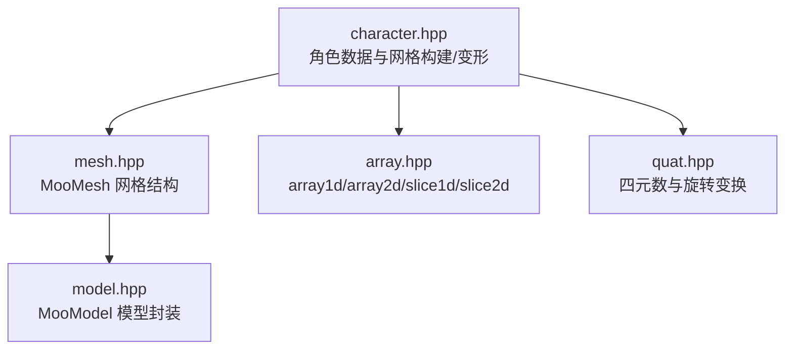
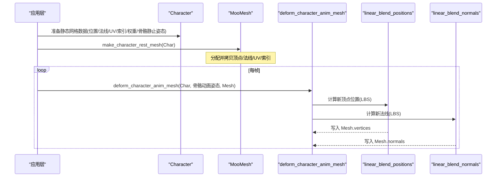
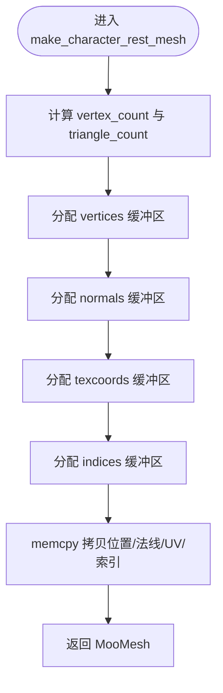
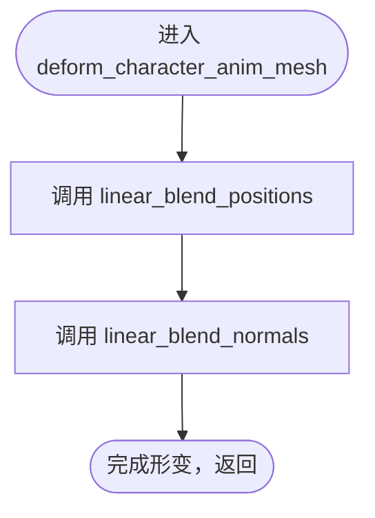
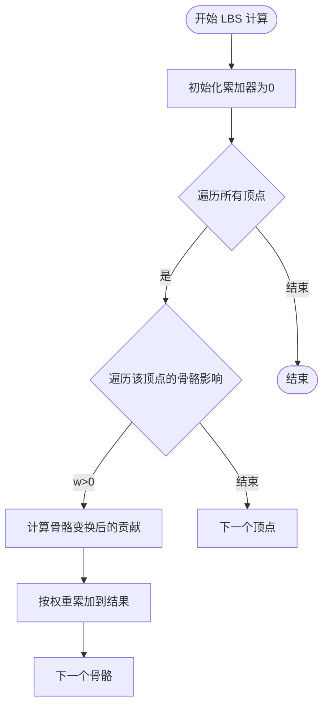
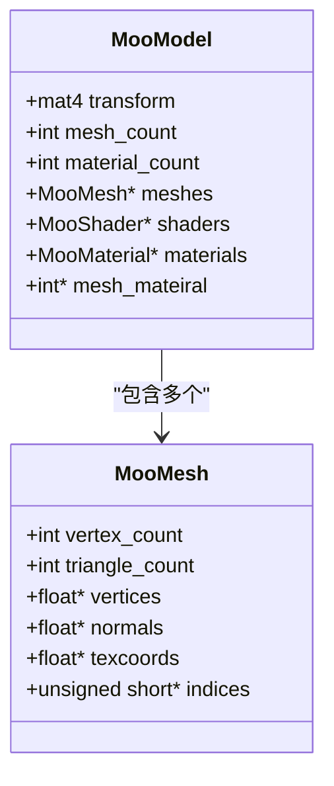

# 网格管理

> **版本提示（2.0）**：本文撰写于 1.x 时期，描述的是旧的实现形态——入口在根目录 `main.cpp`，功能由根目录 `.hpp` 头文件库提供，窗口用 raylib、显示用 OpenCV highgui。2.0 已把这些头文件移到 `Source/Legacy/`，渲染默认走 GPU，窗口与 UI 换成 GLFW + ImGui，`main.cpp` 拆成 `Source/Launch/Private/` 下的 `Main.cpp` 与 `Application`。文中的文件路径、行号与调用链可能已失效，请以根目录的「项目概述」「快速开始」「故障排除」三篇与当前源码为准。

<cite>
**本文引用的文件**   
- [character.hpp](file://character.hpp)
- [mesh.hpp](file://mesh.hpp)
- [model.hpp](file://model.hpp)
- [array.hpp](file://array.hpp)
- [quat.hpp](file://quat.hpp)
</cite>

## 目录
1. [引言](#引言)
2. [项目结构](#项目结构)
3. [核心组件](#核心组件)
4. [架构总览](#架构总览)
5. [详细组件分析](#详细组件分析)
6. [依赖关系分析](#依赖关系分析)
7. [性能考虑](#性能考虑)
8. [故障排查指南](#故障排查指南)
9. [结论](#结论)
10. [附录：使用示例与生命周期管理](#附录使用示例与生命周期管理)

## 引言
本技术文档聚焦于角色网格管理，重点解释以下能力：
- 如何将 Character 数据结构转换为可渲染的 MooMesh 对象（make_character_rest_mesh）
- 动画过程中如何实时更新网格几何体（deform_character_anim_mesh）
- 网格顶点内存分配、数据复制与索引处理流程
- 网格数据的生命周期管理与优化实践
- 提供创建、修改与销毁角色网格对象的实际用法指引

## 项目结构
本项目采用头文件组织的数据结构与算法模块。与角色网格相关的核心文件如下：
- character.hpp：定义角色骨架、权重、静态网格数据以及网格构建/变形函数
- mesh.hpp：定义通用网格结构 MooMesh 及基础几何生成工具
- model.hpp：将单个网格与材质/着色器组合为模型对象
- array.hpp：提供一维/二维数组与切片访问类型，用于高效数据传递
- quat.hpp：四元数与向量旋转相关运算

图表来源
- [character.hpp:35-47](file://character.hpp#L35-L47)
- [mesh.hpp:6-14](file://mesh.hpp#L6-L14)
- [model.hpp:8-19](file://model.hpp#L8-L19)

章节来源
- [character.hpp:35-47](file://character.hpp#L35-L47)
- [mesh.hpp:6-14](file://mesh.hpp#L6-L14)
- [model.hpp:8-19](file://model.hpp#L8-L19)

## 核心组件
- Character：包含角色的静态位置、法线、纹理坐标、三角索引、骨骼权重与骨骼静止姿态等数据
- MooMesh：包含顶点计数、三角形计数、顶点位置、法线、纹理坐标与索引指针
- 辅助函数：
  - make_character_rest_mesh：从 Character 构造可渲染的 MooMesh
  - deform_character_anim_mesh：根据动画骨骼姿态对 MooMesh 进行实时形变
  - linear_blend_positions / linear_blend_normals：基于骨骼权重的线性插值（LBS）实现

章节来源
- [character.hpp:35-47](file://character.hpp#L35-L47)
- [character.hpp:123-164](file://character.hpp#L123-L164)
- [mesh.hpp:6-14](file://mesh.hpp#L6-L14)

## 架构总览
角色网格的生命周期分为三个阶段：
1. 构建阶段：从 Character 数据构建不可变或半可变的基础网格（make_character_rest_mesh）
2. 动画阶段：每帧根据骨骼动画更新顶点与法线（deform_character_anim_mesh）
3. 渲染阶段：通过模型/材质/着色器将网格提交到渲染管线

图表来源
- [character.hpp:123-164](file://character.hpp#L123-L164)
- [character.hpp:68-121](file://character.hpp#L68-L121)

## 详细组件分析

### 组件A：make_character_rest_mesh（角色静态网格构建）
职责：
- 读取 Character 中的静态顶点位置、法线、纹理坐标与三角索引
- 在堆上为 MooMesh 的四个缓冲区分配内存
- 将 Character 数据复制到 MooMesh 对应缓冲区
- 设置顶点计数与三角形计数

关键流程
- 顶点位置：按连续 float 三元组布局存储，大小为 vertex_count * 3
- 法线：同样为连续 float 三元组布局
- 纹理坐标：连续 float 二元组布局
- 索引：unsigned short 数组，长度为 triangle_count * 3

复杂度
- 时间：O(V + I)，V 为顶点数，I 为索引数（仅拷贝）
- 空间：额外分配 O(V + V + V + I) 字节

图表来源
- [character.hpp:123-140](file://character.hpp#L123-L140)

章节来源
- [character.hpp:123-140](file://character.hpp#L123-L140)

### 组件B：deform_character_anim_mesh（动画时网格形变）
职责：
- 接收当前骨骼动画的姿态（位置与旋转）
- 调用线性混合蒙皮（LBS）更新顶点位置与法线
- 直接写回 MooMesh 的顶点与法线缓冲区，供下一帧渲染使用

内部步骤
- 调用 linear_blend_positions：
  - 遍历每个顶点
  - 查找该顶点关联的骨骼ID与权重
  - 对每个有效骨骼，计算其在动画下的变换后的局部位置
  - 按权重加权求和得到最终位置
- 调用 linear_blend_normals：
  - 遍历每个顶点
  - 对每个有效骨骼，将静止法线经相对旋转映射到动画空间
  - 按权重加权求和得到最终法线

复杂度
- 时间：O(V * K)，K 为每个顶点的最大骨骼影响数（通常为常数，如4）
- 空间：原地更新，无额外大内存分配

图表来源
- [character.hpp:142-164](file://character.hpp#L142-L164)
- [character.hpp:68-121](file://character.hpp#L68-L121)

章节来源
- [character.hpp:68-121](file://character.hpp#L68-L121)
- [character.hpp:142-164](file://character.hpp#L142-L164)

### 组件C：线性混合蒙皮（LBS）实现细节
- linear_blend_positions：
  - 输入：动画骨骼位置/旋转、静止骨骼位置/旋转、顶点静止位置、骨骼权重与ID
  - 输出：动画顶点位置
  - 核心公式：对每个顶点 i，累加 w(i,j) * (R_a(j) * inv(R_r(j)) * (p_i - p_r(j)) + p_a(j))
- linear_blend_normals：
  - 输入：动画骨骼旋转、静止法线、静止骨骼旋转、权重与ID
  - 输出：动画法线
  - 核心公式：对每个顶点 i，累加 w(i,j) * R_a(j) * inv(R_r(j)) * n_i

注意：
- 法线不随骨骼平移变化，只受旋转影响
- 权重为零的骨骼被跳过，减少无效计算

图表来源
- [character.hpp:68-121](file://character.hpp#L68-L121)

章节来源
- [character.hpp:68-121](file://character.hpp#L68-L121)

### 组件D：MooMesh 与 MooModel 的关系
- MooMesh：承载几何数据（顶点、法线、UV、索引）
- MooModel：将多个 MooMesh 与材质/着色器组合，便于批量渲染

图表来源
- [mesh.hpp:6-14](file://mesh.hpp#L6-L14)
- [model.hpp:8-19](file://model.hpp#L8-L19)

章节来源
- [mesh.hpp:6-14](file://mesh.hpp#L6-L14)
- [model.hpp:8-19](file://model.hpp#L8-L19)

## 依赖关系分析
- character.hpp 依赖：
  - array.hpp：提供 array1d/array2d 与 slice1d/slice2d，用于高效读写与切片访问
  - mesh.hpp：返回/操作 MooMesh
  - quat.hpp：四元数旋转与逆变换
- mesh.hpp 依赖：
  - mat.hpp：矩阵与向量类型（由其他头文件引入）
- model.hpp 依赖：
  - mesh.hpp：包含 MooMesh
  - shader.hpp：包含 MooShader（用于模型渲染）

耦合与内聚
- character.hpp 高内聚：角色数据与网格构建/形变逻辑集中在同一模块
- mesh.hpp 低耦合：仅提供基础网格结构，便于复用
- model.hpp 作为上层装配器，将网格与渲染资源组合

潜在循环依赖
- 未见循环引用；各模块单向依赖

外部依赖点
- 标准库 malloc/memcpy 用于内存分配与拷贝
- 文件系统接口用于加载角色数据（character_load）

章节来源
- [character.hpp:1-7](file://character.hpp#L1-L7)
- [mesh.hpp:1-5](file://mesh.hpp#L1-L5)
- [model.hpp:1-6](file://model.hpp#L1-L6)

## 性能考虑
- 内存分配策略
  - 使用 malloc 一次性分配大块连续内存，利于缓存友好与 memcpy 优化
  - 避免在动画循环中频繁分配/释放，以减少碎片化与系统开销
- 数据布局
  - 顶点位置/法线采用连续 float 三元组，纹理坐标为二元组，索引为 unsigned short，降低带宽占用
- 计算优化
  - LBS 中跳过权重为0的骨骼，减少无用计算
  - 可考虑向量化（SIMD）或并行化外层顶点循环以提升吞吐
- 渲染路径
  - 建议在 GPU 侧使用顶点缓冲对象（VBO）与索引缓冲对象（IBO），并在 CPU 侧仅做必要的形变计算

[本节为通用指导，不直接分析具体文件]

## 故障排查指南
常见问题与定位要点：
- 内存泄漏
  - 现象：程序运行后内存持续增长
  - 检查点：确保在销毁 MooMesh 前释放其 vertices/normals/texcoords/indices 四个缓冲区
- 越界访问
  - 现象：崩溃或渲染异常
  - 检查点：确认 vertex_count/triangle_count 与实际缓冲区大小一致；索引范围不超过顶点数
- 法线不正确
  - 现象：光照异常或表面出现黑斑
  - 检查点：确认 linear_blend_normals 正确使用了旋转而非平移；权重归一化是否合理
- 动画抖动
  - 现象：网格在动画中出现撕裂或抖动
  - 检查点：检查骨骼静止姿态与动画姿态的一致性；权重分布是否合理

章节来源
- [character.hpp:68-121](file://character.hpp#L68-L121)
- [character.hpp:123-164](file://character.hpp#L123-L164)

## 结论
- make_character_rest_mesh 负责将 Character 的静态网格数据安全地复制到 MooMesh，完成内存分配与数据拷贝
- deform_character_anim_mesh 在动画过程中通过 LBS 实时计算顶点与法线，保持渲染所需的几何一致性
- 合理的内存生命周期管理与数据布局是保证性能与稳定性的关键
- 建议在上层封装统一的创建/更新/销毁接口，以简化使用并避免内存错误

[本节为总结性内容，不直接分析具体文件]

## 附录：使用示例与生命周期管理

### 生命周期最佳实践
- 创建
  - 使用 make_character_rest_mesh 从 Character 构建 MooMesh
- 更新
  - 每帧调用 deform_character_anim_mesh，传入最新骨骼动画姿态
- 销毁
  - 依次 free 四个缓冲区：vertices、normals、texcoords、indices
  - 若通过 MooModel 持有多个 MooMesh，需先释放模型层面的资源，再逐个释放网格缓冲区

注意事项
- 不要在动画循环中重复分配/释放 MooMesh 的缓冲区
- 确保在销毁前停止对该网格的写入与渲染访问
- 若使用多线程，需对形变与渲染进行同步保护

章节来源
- [character.hpp:123-164](file://character.hpp#L123-L164)
- [mesh.hpp:6-14](file://mesh.hpp#L6-L14)