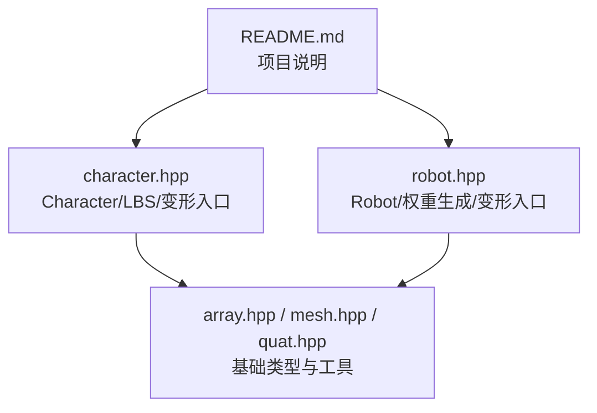
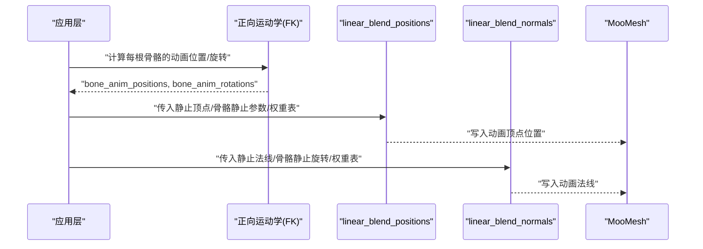
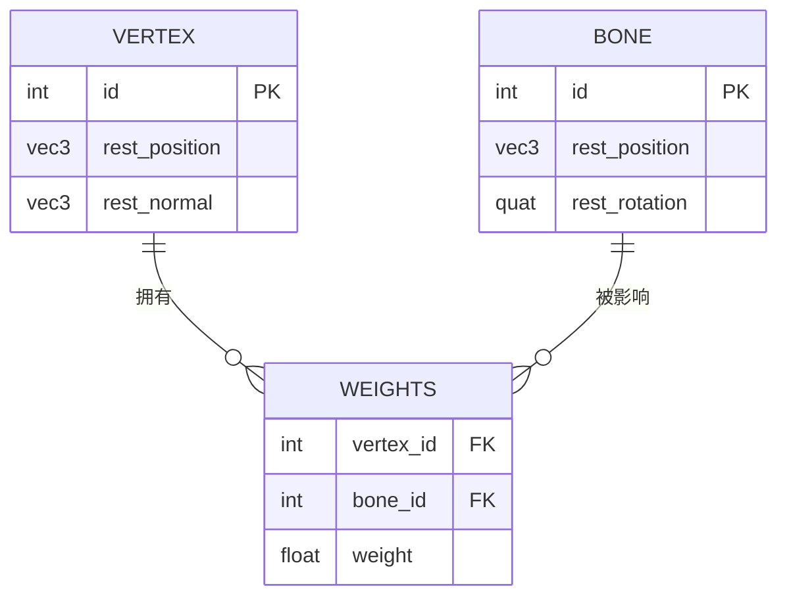
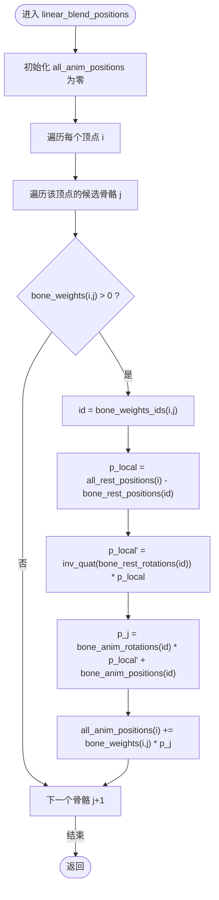
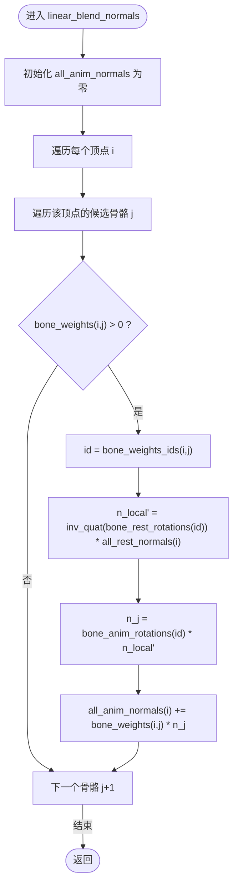
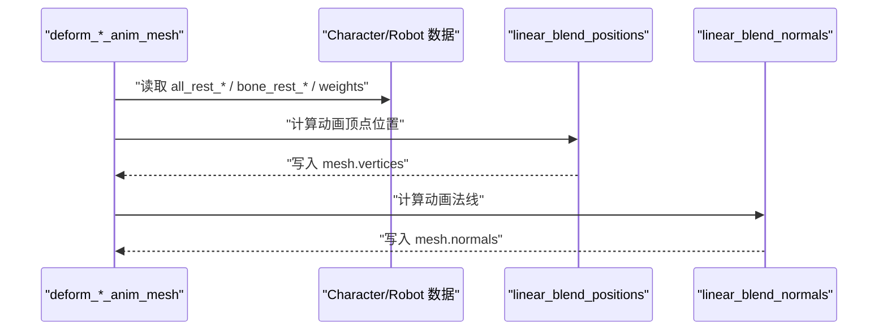
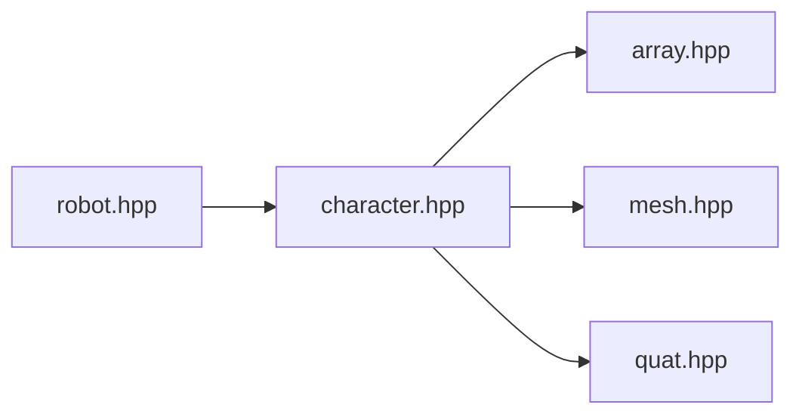

# 蒙皮变形

> **版本提示（2.0）**：本文撰写于 1.x 时期，描述的是旧的实现形态——入口在根目录 `main.cpp`，功能由根目录 `.hpp` 头文件库提供，窗口用 raylib、显示用 OpenCV highgui。2.0 已把这些头文件移到 `Source/Legacy/`，渲染默认走 GPU，窗口与 UI 换成 GLFW + ImGui，`main.cpp` 拆成 `Source/Launch/Private/` 下的 `Main.cpp` 与 `Application`。文中的文件路径、行号与调用链可能已失效，请以根目录的「项目概述」「快速开始」「故障排除」三篇与当前源码为准。

<cite>
**本文引用的文件**   
- [character.hpp](file://character.hpp)
- [robot.hpp](file://robot.hpp)
- [README.md](file://README.md)
</cite>

## 目录
1. [简介](#简介)
2. [项目结构](#项目结构)
3. [核心组件](#核心组件)
4. [架构总览](#架构总览)
5. [详细组件分析](#详细组件分析)
6. [依赖关系分析](#依赖关系分析)
7. [性能考虑与优化](#性能考虑与优化)
8. [故障排查指南](#故障排查指南)
9. [结论](#结论)
10. [附录：数据格式与验证方法](#附录数据格式与验证方法)

## 简介
本技术文档聚焦于MooLab中的线性混合蒙皮（Linear Blend Skinning, LBS）实现，系统阐述其数学原理、数据结构与代码流程。重点包括：
- 顶点位置与法线的LBS加权平均计算
- bone_weights与bone_weights_ids的数据组织方式
- linear_blend_positions与linear_blend_normals的算法推导与实现细节
- 性能优化策略（权重阈值处理、循环优化等）
- 结果验证方法与示例路径

## 项目结构
本项目为角色运动渲染与仿真器，包含骨骼动画、IK求解、网格加载与蒙皮变形等功能。与蒙皮变形直接相关的核心头文件如下：
- character.hpp：定义Character结构体、骨骼枚举、LBS函数接口以及角色网格变形入口
- robot.hpp：定义Robot结构体、机器人网格生成与权重分配逻辑，并复用LBS接口进行变形

图表来源
- [README.md:1-22](file://README.md#L1-L22)
- [character.hpp:1-166](file://character.hpp#L1-L166)
- [robot.hpp:1-403](file://robot.hpp#L1-L403)

章节来源
- [README.md:1-22](file://README.md#L1-L22)

## 核心组件
- Character结构体：承载角色网格的静止顶点/法线/纹理坐标/索引，以及每个顶点对应的多骨骼权重与骨骼ID，还有骨骼的静止位置与旋转。
- Robot结构体：承载机器人网格与骨骼树信息，并提供自动生成网格与权重的工具函数。
- LBS函数：
  - linear_blend_positions：对每个顶点按权重对多个骨骼变换后的位置进行加权求和
  - linear_blend_normals：对每个顶点按权重对多个骨骼旋转后的法线进行加权求和
- 变形入口：
  - deform_character_anim_mesh：将LBS应用于角色网格
  - deform_robot_anim_mesh：将LBS应用于机器人网格

章节来源
- [character.hpp:35-47](file://character.hpp#L35-L47)
- [character.hpp:68-121](file://character.hpp#L68-L121)
- [character.hpp:142-164](file://character.hpp#L142-L164)
- [robot.hpp:6-43](file://robot.hpp#L6-L43)
- [robot.hpp:238-260](file://robot.hpp#L238-L260)

## 架构总览
下图展示了从“骨骼动画数据”到“网格顶点/法线变形”的整体流程。

图表来源
- [character.hpp:68-121](file://character.hpp#L68-L121)
- [character.hpp:142-164](file://character.hpp#L142-L164)
- [robot.hpp:238-260](file://robot.hpp#L238-L260)

## 详细组件分析

### 数据结构：bone_weights与bone_weights_ids
- bone_weights：二维数组，行对应网格顶点，列对应最多影响的骨骼数量（例如4）。元素值为该顶点对应骨骼的权重（浮点）。
- bone_weights_ids：二维数组，维度与bone_weights一致，元素为骨骼ID（无符号短整型），用于索引对应的骨骼变换。
- 典型用途：每个顶点最多受固定数量的骨骼影响（如4），便于在CPU/GPU上高效遍历与向量化。

图表来源
- [character.hpp:35-47](file://character.hpp#L35-L47)
- [robot.hpp:20-43](file://robot.hpp#L20-L43)

章节来源
- [character.hpp:35-47](file://character.hpp#L35-L47)
- [robot.hpp:20-43](file://robot.hpp#L20-L43)

### 线性混合蒙皮：位置变形 linear_blend_positions
- 输入：
  - all_rest_positions：静止空间下的网格顶点位置
  - bone_rest_positions/bone_rest_rotations：骨骼在静止空间的平移与旋转
  - bone_anim_positions/bone_anim_rotations：动画空间中骨骼的平移与旋转
  - bone_weights_ids/bone_weights：每个顶点对应的影响骨骼ID与权重
- 输出：
  - all_anim_positions：动画空间下经LBS变形的顶点位置
- 数学推导：
  - 对第i个顶点，设其受k个骨骼影响，权重为w_{i,j}，骨骼ID为b_{i,j}
  - 局部偏移：p_local = all_rest_positions(i) - bone_rest_positions(b_{i,j})
  - 逆回静止旋转：p_local' = inv_quat(bone_rest_rotations(b_{i,j})) * p_local
  - 应用动画旋转和平移：p_j = bone_anim_rotations(b_{i,j}) * p_local' + bone_anim_positions(b_{i,j})
  - 加权求和：all_anim_positions(i) = Σ_j w_{i,j} * p_j
- 实现要点：
  - 外层遍历所有顶点，内层遍历最多影响的骨骼数（由bone_weights_ids.cols决定）
  - 通过bone_weights(i,j) > 0.f跳过零权重项，减少无效计算
  - 使用四元数乘法表示旋转，避免万向锁问题

图表来源
- [character.hpp:68-95](file://character.hpp#L68-L95)

章节来源
- [character.hpp:68-95](file://character.hpp#L68-L95)

### 线性混合蒙皮：法线变形 linear_blend_normals
- 输入：
  - all_rest_normals：静止空间下的网格顶点法线
  - bone_rest_rotations：骨骼在静止空间的旋转
  - bone_anim_rotations：动画空间中骨骼的旋转
  - bone_weights_ids/bone_weights：权重与骨骼ID
- 输出：
  - all_anim_normals：动画空间下经LBS变形的顶点法线
- 数学推导：
  - 对第i个顶点，法线只受旋转影响（不含平移）
  - 局部法线归一化后，先逆回静止旋转：n_local' = inv_quat(bone_rest_rotations(b_{i,j})) * all_rest_normals(i)
  - 应用动画旋转：n_j = bone_anim_rotations(b_{i,j}) * n_local'
  - 加权求和：all_anim_normals(i) = Σ_j w_{i,j} * n_j
- 实现要点：
  - 同样通过bone_weights(i,j) > 0.f跳过零权重项
  - 注意：最终法线通常需要在着色阶段再次归一化以保证光照正确性

图表来源
- [character.hpp:97-121](file://character.hpp#L97-L121)

章节来源
- [character.hpp:97-121](file://character.hpp#L97-L121)

### 变形入口：deform_character_anim_mesh 与 deform_robot_anim_mesh
- 作用：封装LBS调用，将静态网格数据与动画骨骼数据结合，输出可渲染的动画网格
- 流程：
  - 调用linear_blend_positions更新顶点位置
  - 调用linear_blend_normals更新顶点法线
- 适用对象：
  - 角色模型（Character）
  - 机器人模型（Robot）

图表来源
- [character.hpp:142-164](file://character.hpp#L142-L164)
- [robot.hpp:238-260](file://robot.hpp#L238-L260)

章节来源
- [character.hpp:142-164](file://character.hpp#L142-L164)
- [robot.hpp:238-260](file://robot.hpp#L238-L260)

## 依赖关系分析
- character.hpp依赖：
  - array.hpp：提供array1d/array2d与slice1d/slice2d容器
  - mesh.hpp：提供MooMesh结构体
  - quat.hpp：提供四元数运算（含inv_quat）
- robot.hpp依赖：
  - character.hpp：复用LBS函数接口
  - 自身包含机器人网格构建与权重生成逻辑

图表来源
- [character.hpp:1-7](file://character.hpp#L1-L7)
- [robot.hpp:1-5](file://robot.hpp#L1-L5)

章节来源
- [character.hpp:1-7](file://character.hpp#L1-L7)
- [robot.hpp:1-5](file://robot.hpp#L1-L5)

## 性能考虑与优化
- 权重阈值处理：
  - 在两个LBS函数中均通过bone_weights(i,j) > 0.f跳过零权重项，显著减少无效的四元数与向量运算
- 循环优化建议：
  - 预取与缓存：将bone_anim_positions、bone_anim_rotations、bone_rest_positions、bone_rest_rotations以连续内存布局访问，提升缓存命中率
  - 并行化：外层顶点循环可并行化（OpenMP/C++ std::parallel_for），因为各顶点之间相互独立
  - SIMD向量化：对固定最大骨骼数（如4）的内层循环进行SIMD展开，减少分支判断
  - 提前终止：若某顶点仅受1个骨骼影响，可直接赋值而非累加
- 数值稳定性：
  - 法线在着色前需再次归一化，避免多次插值导致的长度变化
  - 四元数应保持单位长度，必要时进行归一化
- I/O与数据布局：
  - 确保bone_weights与bone_weights_ids按顶点顺序连续存储，避免跨步访问
  - 对于大规模网格，考虑分块处理以减少内存峰值

[本节为通用性能指导，不直接分析具体文件]

## 故障排查指南
- 常见问题与定位：
  - 顶点位置异常抖动或拉伸：检查bone_weights是否归一化（Σw=1），以及bone_weights_ids与bone_weights行列对齐是否正确
  - 法线方向错误：确认法线LBS未包含平移；在着色阶段对法线进行归一化
  - 性能瓶颈：统计bone_weights(i,j) > 0.f的稀疏度，评估并行化收益；检查内存访问模式是否连续
- 调试建议：
  - 打印单个顶点的权重与骨骼ID，验证是否与预期一致
  - 对比静止网格与动画网格的顶点距离，定位异常区域
  - 使用可视化查看中间结果（如每个骨骼单独贡献的位置）

章节来源
- [character.hpp:68-121](file://character.hpp#L68-L121)
- [robot.hpp:319-361](file://robot.hpp#L319-L361)

## 结论
MooLab的LBS实现简洁而高效：通过bone_weights与bone_weights_ids将网格顶点与多骨骼关联，并在CPU端完成位置与法线的加权平均。该实现具备良好的可扩展性与可并行性，适合在实时渲染管线中使用。配合合理的权重生成策略与性能优化手段，可在保证视觉质量的同时获得良好的运行效率。

[本节为总结性内容，不直接分析具体文件]

## 附录：数据格式与验证方法
- 数据加载与保存：
  - Character与Robot均支持从二进制文件读取/写入网格与权重数据
  - 关键字段包括：静止顶点/法线、纹理坐标、索引、权重矩阵、骨骼ID矩阵、骨骼静止位置/旋转
- 权重生成示例（机器人）：
  - 基于顶点到骨骼的距离排序，选取最近4个骨骼
  - 根据父子骨骼关系与几何关系计算权重，并进行归一化
- 结果验证步骤：
  - 构造已知姿态（如直立），比较变形后网格与手工预期
  - 对单一骨骼施加旋转，观察相邻顶点平滑过渡
  - 对法线进行归一化后渲染，检查光照连续性

章节来源
- [character.hpp:49-66](file://character.hpp#L49-L66)
- [robot.hpp:45-89](file://robot.hpp#L45-L89)
- [robot.hpp:319-361](file://robot.hpp#L319-L361)