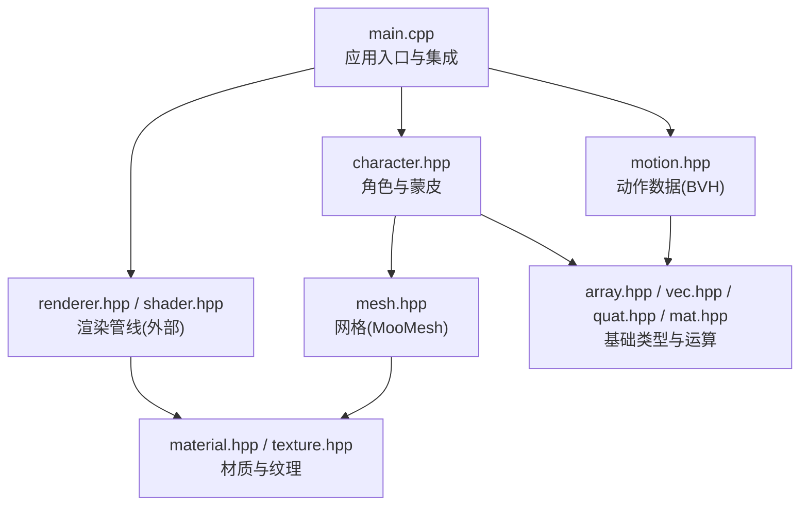
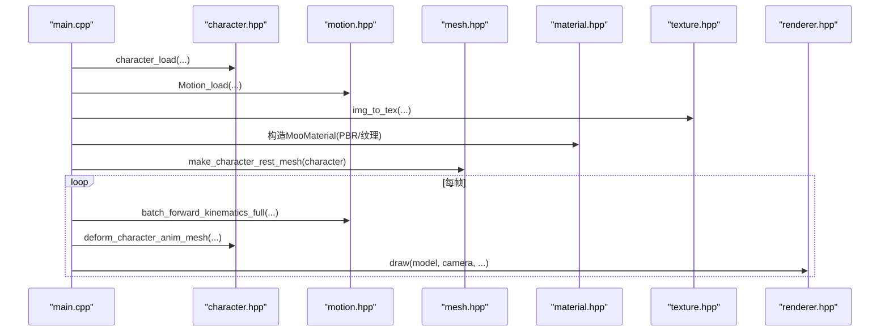
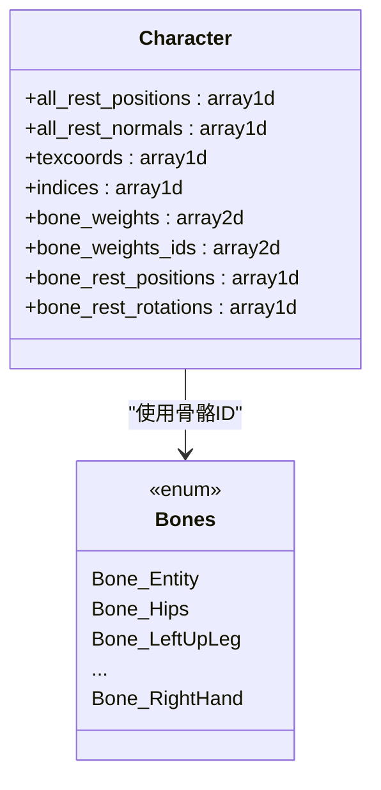
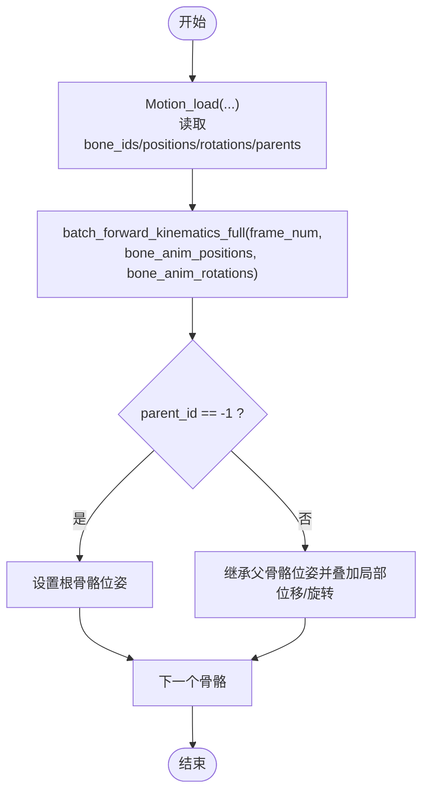
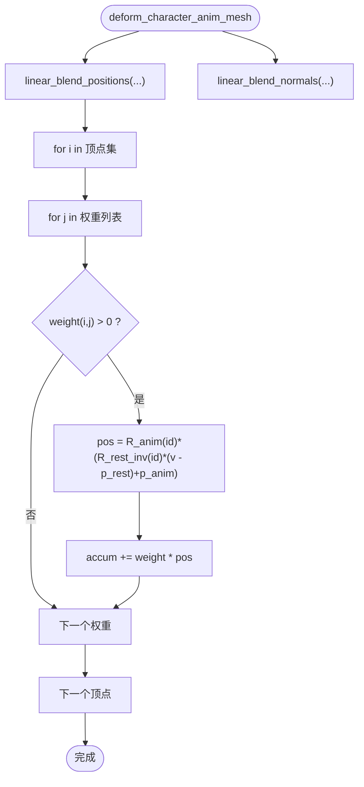
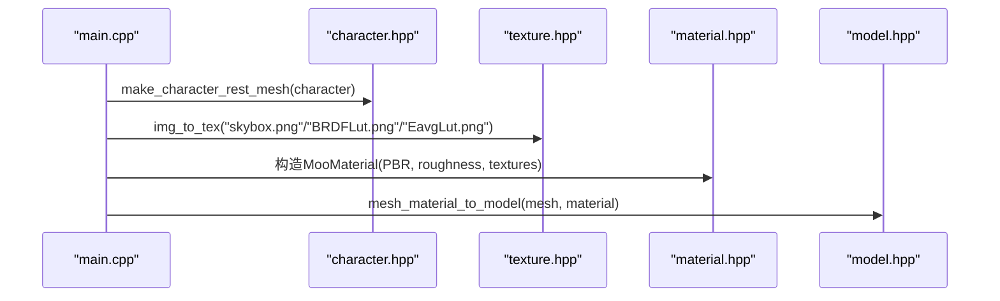
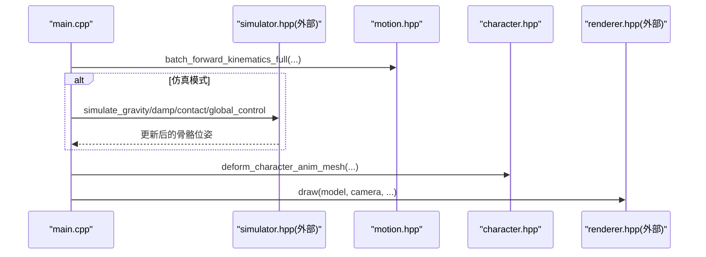
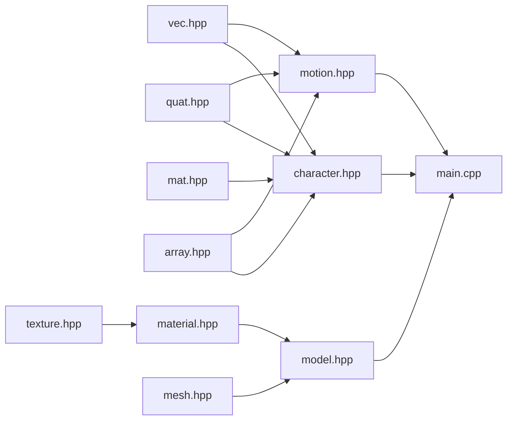

# 角色系统

> **版本提示（2.0）**：本文撰写于 1.x 时期，描述的是旧的实现形态——入口在根目录 `main.cpp`，功能由根目录 `.hpp` 头文件库提供，窗口用 raylib、显示用 OpenCV highgui。2.0 已把这些头文件移到 `Source/Legacy/`，渲染默认走 GPU，窗口与 UI 换成 GLFW + ImGui，`main.cpp` 拆成 `Source/Launch/Private/` 下的 `Main.cpp` 与 `Application`。文中的文件路径、行号与调用链可能已失效，请以根目录的「项目概述」「快速开始」「故障排除」三篇与当前源码为准。

<cite>
**本文引用的文件**   
- [README.md](file://README.md)
- [main.cpp](file://main.cpp)
- [character.hpp](file://character.hpp)
- [motion.hpp](file://motion.hpp)
- [mesh.hpp](file://mesh.hpp)
- [model.hpp](file://model.hpp)
- [material.hpp](file://material.hpp)
- [texture.hpp](file://texture.hpp)
- [array.hpp](file://array.hpp)
- [quat.hpp](file://quat.hpp)
- [vec.hpp](file://vec.hpp)
- [mat.hpp](file://mat.hpp)
</cite>

## 目录
1. [引言](#引言)
2. [项目结构](#项目结构)
3. [核心组件](#核心组件)
4. [架构总览](#架构总览)
5. [详细组件分析](#详细组件分析)
6. [依赖关系分析](#依赖关系分析)
7. [性能考量](#性能考量)
8. [故障排查指南](#故障排查指南)
9. [结论](#结论)
10. [附录：数据格式与规范](#附录数据格式与规范)

## 引言
本文件面向MooLab的角色系统，系统性阐述角色数据结构、骨骼层次、蒙皮变形算法、BVH动作数据加载流程、材质与纹理处理、以及角色系统与动画/渲染系统的集成方式。文档以代码为依据，提供可视化图示与可操作的步骤说明，帮助读者从概念到实现全面理解角色管线。

## 项目结构
MooLab采用模块化头文件组织，核心角色相关模块包括：
- 角色与蒙皮：character.hpp
- 动作数据（BVH）：motion.hpp
- 网格与几何：mesh.hpp
- 模型与材质：model.hpp, material.hpp, texture.hpp
- 基础数学与数组：vec.hpp, quat.hpp, mat.hpp, array.hpp
- 应用入口与集成：main.cpp

图表来源
- [main.cpp:53-160](file://main.cpp#L53-L160)
- [character.hpp:35-166](file://character.hpp#L35-L166)
- [motion.hpp:37-96](file://motion.hpp#L37-L96)
- [mesh.hpp:6-14](file://mesh.hpp#L6-L14)
- [material.hpp:15-30](file://material.hpp#L15-L30)
- [texture.hpp:65-100](file://texture.hpp#L65-L100)

章节来源
- [README.md:1-22](file://README.md#L1-L22)
- [main.cpp:53-160](file://main.cpp#L53-L160)

## 核心组件
- 角色数据 Character：包含静态网格顶点、法线、UV、索引、骨骼权重与权重ID、骨骼初始位置与旋转等。
- 动作数据 BVH_Motion：包含每帧的骨骼局部位移与旋转、父子关系、骨骼ID映射。
- 网格 MooMesh：存储顶点、法线、UV、三角面索引。
- 模型 MooModel：将网格与材质、着色器关联，并维护变换矩阵。
- 材质 MooMaterial：支持PBR/纹理/法线贴图等多种材质类型，内含纹理对象。
- 纹理 texture：基于OpenCV的图像读取与颜色访问接口。
- 基础类型：vec/quat/mat/array，提供向量、四元数、矩阵与动态数组工具。

章节来源
- [character.hpp:35-47](file://character.hpp#L35-L47)
- [motion.hpp:37-70](file://motion.hpp#L37-L70)
- [mesh.hpp:6-14](file://mesh.hpp#L6-L14)
- [model.hpp:8-19](file://model.hpp#L8-L19)
- [material.hpp:15-30](file://material.hpp#L15-L30)
- [texture.hpp:65-100](file://texture.hpp#L65-L100)
- [array.hpp:45-88](file://array.hpp#L45-L88)

## 架构总览
角色系统的数据流如下：
- 资源加载：从二进制文件加载角色数据与动作数据；纹理通过OpenCV加载。
- 动画驱动：对BVH_Motion进行前向运动学计算，得到全局骨骼位姿。
- 蒙皮变形：根据骨骼权重与位姿，线性插值更新网格顶点与法线。
- 渲染输出：将更新后的网格与材质、光照信息提交给渲染器绘制。

图表来源
- [main.cpp:71-124](file://main.cpp#L71-L124)
- [main.cpp:298-428](file://main.cpp#L298-L428)
- [character.hpp:49-66](file://character.hpp#L49-L66)
- [motion.hpp:72-96](file://motion.hpp#L72-L96)
- [texture.hpp:86-100](file://texture.hpp#L86-L100)

## 详细组件分析

### 角色数据结构与骨骼系统
- 骨骼枚举 Bones：定义了标准人体骨骼命名与编号，涵盖躯干、四肢、手部、头部等关键关节。
- Character 结构体：
  - all_rest_positions/all_rest_normals：角色在绑定姿态下的顶点位置与法线。
  - texcoords/indices：纹理坐标与三角面索引。
  - bone_weights/bone_weights_ids：每个顶点对应的前N个骨骼权重与ID（稀疏存储）。
  - bone_rest_positions/bone_rest_rotations：各骨骼在绑定姿态下的初始位置与旋转。

图表来源
- [character.hpp:8-47](file://character.hpp#L8-L47)

章节来源
- [character.hpp:8-47](file://character.hpp#L8-L47)

### BVH动作数据的解析与加载机制
- BVH_Motion 结构体：
  - bone_ids：骨骼ID映射。
  - bone_local_positions/bone_local_rotations：每帧的骨骼局部位移与旋转（行=帧，列=骨骼）。
  - bone_parents：父节点索引（根为-1）。
- 加载/保存：Motion_load/Motion_save通过array1d_read/array2d_read直接读写二进制数据。
- 前向运动学：batch_forward_kinematics_full/part/root依次计算全局骨骼位姿，假设骨骼按从根到叶的顺序排列。

图表来源
- [motion.hpp:72-96](file://motion.hpp#L72-L96)
- [motion.hpp:122-150](file://motion.hpp#L122-L150)

章节来源
- [motion.hpp:37-96](file://motion.hpp#L37-L96)
- [motion.hpp:122-150](file://motion.hpp#L122-L150)

### 蒙皮变形算法（线性混合蒙皮 LBS）
- linear_blend_positions：对每个顶点，遍历其非零权重的骨骼，计算该骨骼在动画帧中的世界变换，将绑定态顶点转换到动画空间后加权求和。
- linear_blend_normals：对法线仅考虑旋转部分，按相同权重组合。
- deform_character_anim_mesh：封装上述两个函数，将结果写回MooMesh的顶点与法线缓冲区。

图表来源
- [character.hpp:68-121](file://character.hpp#L68-L121)
- [character.hpp:142-164](file://character.hpp#L142-L164)

章节来源
- [character.hpp:68-121](file://character.hpp#L68-L121)
- [character.hpp:142-164](file://character.hpp#L142-L164)

### 角色模型的导入流程（网格、纹理、材质）
- 网格：make_character_rest_mesh将Character中的静态网格数据拷贝到MooMesh。
- 纹理：img_to_tex通过OpenCV读取图片并转换为texture对象。
- 材质：MooMaterial支持PBR/纹理/法线贴图，并可携带BRDF/Eavg查找表纹理。
- 模型：mesh_material_to_model将单个MooMesh与MooMaterial打包为MooModel，并初始化着色器类型。

图表来源
- [main.cpp:101-129](file://main.cpp#L101-L129)
- [character.hpp:123-140](file://character.hpp#L123-L140)
- [texture.hpp:86-100](file://texture.hpp#L86-L100)
- [material.hpp:15-30](file://material.hpp#L15-L30)
- [model.hpp:21-43](file://model.hpp#L21-L43)

章节来源
- [main.cpp:101-129](file://main.cpp#L101-L129)
- [character.hpp:123-140](file://character.hpp#L123-L140)
- [texture.hpp:86-100](file://texture.hpp#L86-L100)
- [material.hpp:15-30](file://material.hpp#L15-L30)
- [model.hpp:21-43](file://model.hpp#L21-L43)

### 角色系统与动画系统、渲染系统的集成
- 动画系统：main.cpp中调用batch_forward_kinematics_full或仿真器输出的骨骼位姿，驱动角色动画。
- 渲染系统：将更新后的MooMesh与MooModel提交给draw函数进行绘制；光源与相机参数由main.cpp管理。
- 交互控制：手柄输入用于调整相机与角色速度/角速度，进而影响动作选择与仿真控制。

图表来源
- [main.cpp:298-428](file://main.cpp#L298-L428)
- [motion.hpp:122-150](file://motion.hpp#L122-L150)
- [character.hpp:142-164](file://character.hpp#L142-L164)

章节来源
- [main.cpp:298-428](file://main.cpp#L298-L428)

## 依赖关系分析
- 角色模块依赖基础数学与数组库：vec/quat/mat/array。
- 动作模块依赖四元数与数组库，提供运动学计算。
- 渲染模块依赖材质与纹理，材质依赖纹理。
- main.cpp作为应用入口，协调角色、动作、仿真、渲染与UI。

图表来源
- [character.hpp:4-6](file://character.hpp#L4-L6)
- [motion.hpp:4-6](file://motion.hpp#L4-L6)
- [material.hpp:4-5](file://material.hpp#L4-L5)
- [model.hpp:4-6](file://model.hpp#L4-L6)
- [main.cpp:8-17](file://main.cpp#L8-L17)

章节来源
- [character.hpp:4-6](file://character.hpp#L4-L6)
- [motion.hpp:4-6](file://motion.hpp#L4-L6)
- [material.hpp:4-5](file://material.hpp#L4-L5)
- [model.hpp:4-6](file://model.hpp#L4-L6)
- [main.cpp:8-17](file://main.cpp#L8-L17)

## 性能考量
- 蒙皮变形复杂度：O(V*K)，其中V为顶点数，K为每个顶点参与变形的骨骼数量（通常较小）。可通过限制K值与跳过零权重优化。
- 前向运动学：O(F*B)，F为帧数，B为骨骼数；批量计算时注意缓存局部变量以减少重复计算。
- 纹理加载：OpenCV读取与颜色转换在启动阶段执行，避免运行时IO瓶颈。
- 内存管理：MooMesh/MooModel使用malloc分配，需注意生命周期与释放策略，避免泄漏。

[本节为通用指导，不直接分析具体文件]

## 故障排查指南
- 角色数据加载失败：检查character.bin路径与二进制格式是否与array1d_read/array2d_read一致。
- 动作数据异常：确认BVH_Motion的bone_parents顺序是否满足“从根到叶”的假设；否则前向运动学结果错误。
- 蒙皮变形异常：检查bone_weights是否为正且归一化；确保bone_rest_positions/rotations与动画位姿坐标系一致。
- 纹理显示异常：确认图片路径正确且OpenCV可用；注意RGB/BGR转换。
- 渲染黑屏或闪烁：检查相机投影与视口设置、光源方向与强度、材质参数是否合理。

章节来源
- [character.hpp:49-66](file://character.hpp#L49-L66)
- [motion.hpp:122-150](file://motion.hpp#L122-L150)
- [texture.hpp:86-100](file://texture.hpp#L86-L100)

## 结论
MooLab的角色系统以清晰的模块化设计实现了从角色数据加载、动作驱动、蒙皮变形到渲染输出的完整管线。通过BVH动作数据与前向运动学，结合线性混合蒙皮算法，系统能够高效地驱动复杂角色模型。材质与纹理的解耦使得渲染效果可调可控。整体架构简洁、可扩展性强，适合进一步扩展IK、物理仿真与高级渲染特性。

[本节为总结性内容，不直接分析具体文件]

## 附录：数据格式与规范

### 角色数据格式（character.bin）
- 字段顺序与类型：
  - all_rest_positions: array1d<vec3>
  - all_rest_normals: array1d<vec3>
  - texcoords: array1d<vec2>
  - indices: array1d<unsigned short>
  - bone_weights: array2d<float>（行=顶点，列=权重槽）
  - bone_weights_ids: array2d<unsigned short>（行=顶点，列=权重槽）
  - bone_rest_positions: array1d<vec3>
  - bone_rest_rotations: array1d<quat>
- 写入/读取：通过array1d_write/array2d_write与array1d_read/array2d_read进行二进制序列化。

章节来源
- [character.hpp:49-66](file://character.hpp#L49-L66)
- [array.hpp:91-106](file://array.hpp#L91-L106)
- [array.hpp:158-176](file://array.hpp#L158-L176)

### 动作数据格式（BVH_Motion）
- 字段顺序与类型：
  - bone_ids: array1d<int>
  - bone_local_positions: array2d<vec3>（行=帧，列=骨骼）
  - bone_local_rotations: array2d<quat>（行=帧，列=骨骼）
  - bone_parents: array1d<int>（根为-1）
- 约束：
  - 骨骼顺序需满足从根到叶的拓扑排序，以便前向运动学正确传播。
  - 每帧的局部位移/旋转定义在父骨骼坐标系下。

章节来源
- [motion.hpp:37-70](file://motion.hpp#L37-L70)
- [motion.hpp:72-96](file://motion.hpp#L72-L96)

### 骨骼命名约定
- 使用Bones枚举定义的命名，如Bone_Hips、Bone_LeftUpLeg、Bone_LeftLeg、Bone_LeftFoot、Bone_LeftToe、Bone_Right*、Bone_Spine*、Bone_Neck、Bone_Head、Bone_LeftShoulder/Arm/ForeArm/Hand、Bone_RightShoulder/Arm/ForeArm/Hand等。
- 这些命名与BVH_Motion的bone_ids映射保持一致，便于跨模块引用。

章节来源
- [character.hpp:8-33](file://character.hpp#L8-L33)

### 权重计算方法
- 当前实现采用线性混合蒙皮（LBS），顶点位置与法线按权重加权组合。
- 权重建议：
  - 每个顶点最多保留若干非零权重（例如4~8），以提升性能。
  - 权重需为正且归一化，以保证形变稳定。
- 权重生成：通常在建模软件中导出，或通过离线工具计算后写入bone_weights与bone_weights_ids。

章节来源
- [character.hpp:68-121](file://character.hpp#L68-L121)

### 实际使用示例（步骤指引）
- 创建角色对象：
  - 准备character.bin，确保字段顺序与类型符合规范。
  - 调用character_load加载到Character结构体。
- 创建网格与模型：
  - 调用make_character_rest_mesh生成MooMesh。
  - 构造MooMaterial（PBR/纹理），并通过mesh_material_to_model生成MooModel。
- 驱动动画：
  - 调用Motion_load加载BVH_Motion。
  - 每帧调用batch_forward_kinematics_full获取全局骨骼位姿。
  - 调用deform_character_anim_mesh更新MooMesh顶点与法线。
- 渲染输出：
  - 将MooModel加入渲染器，设置相机与光源参数，调用draw进行绘制。

章节来源
- [main.cpp:71-129](file://main.cpp#L71-L129)
- [main.cpp:298-428](file://main.cpp#L298-L428)
- [character.hpp:49-66](file://character.hpp#L49-L66)
- [motion.hpp:72-96](file://motion.hpp#L72-L96)
- [character.hpp:123-164](file://character.hpp#L123-L164)