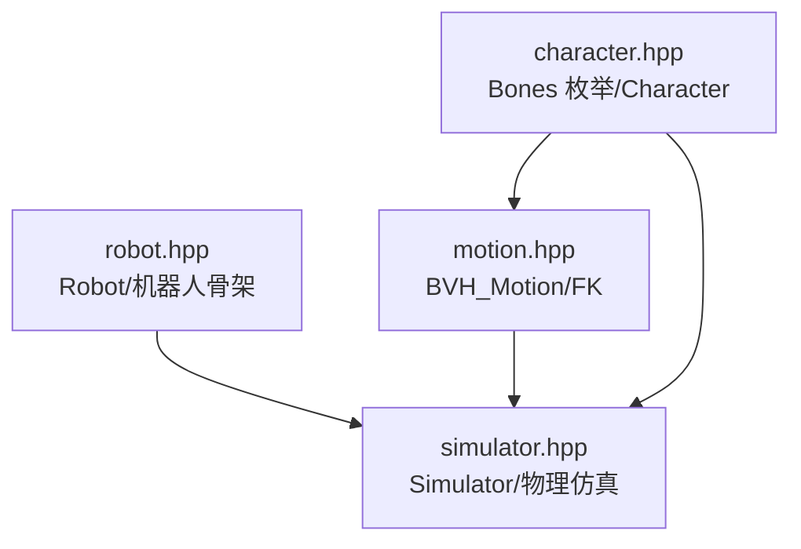
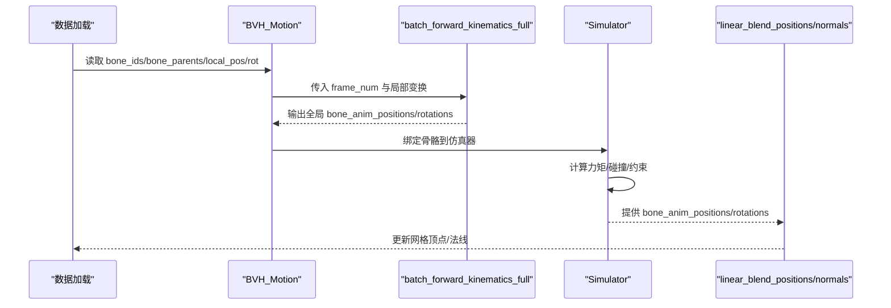
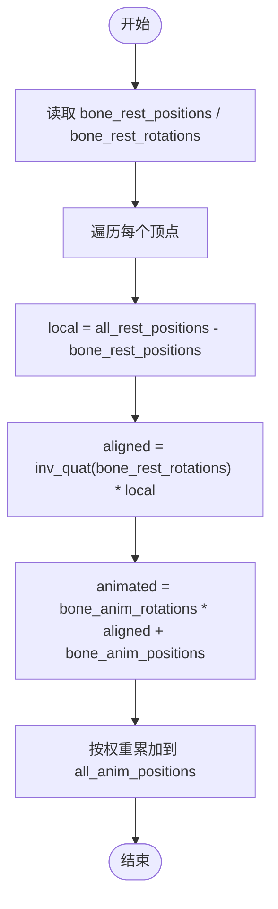
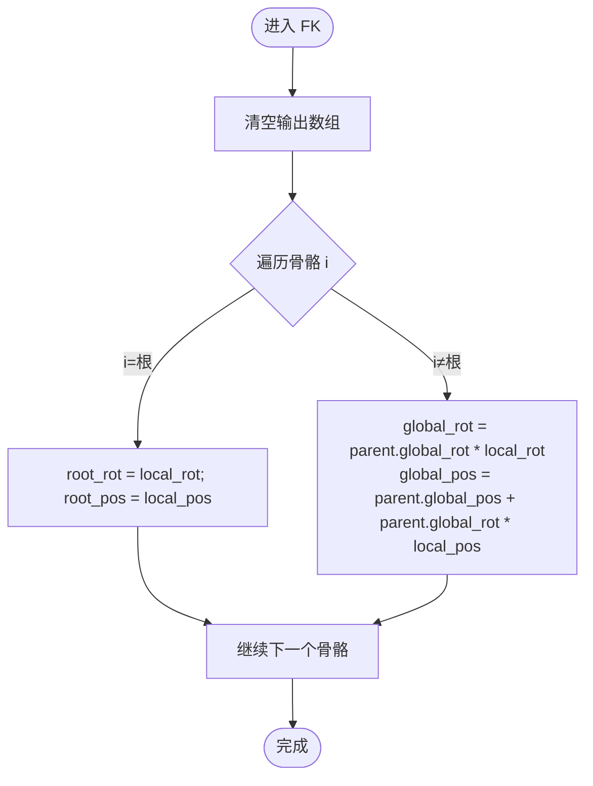
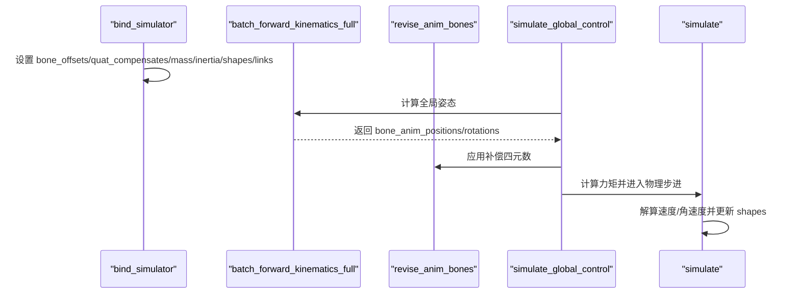
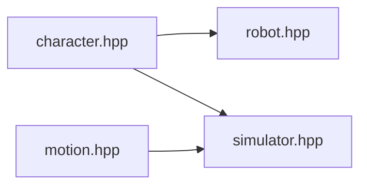

# 骨骼系统

> **版本提示（2.0）**：本文撰写于 1.x 时期，描述的是旧的实现形态——入口在根目录 `main.cpp`，功能由根目录 `.hpp` 头文件库提供，窗口用 raylib、显示用 OpenCV highgui。2.0 已把这些头文件移到 `Source/Legacy/`，渲染默认走 GPU，窗口与 UI 换成 GLFW + ImGui，`main.cpp` 拆成 `Source/Launch/Private/` 下的 `Main.cpp` 与 `Application`。文中的文件路径、行号与调用链可能已失效，请以根目录的「项目概述」「快速开始」「故障排除」三篇与当前源码为准。

<cite>
**本文引用的文件**   
- [character.hpp](file://character.hpp)
- [motion.hpp](file://motion.hpp)
- [robot.hpp](file://robot.hpp)
- [simulator.hpp](file://simulator.hpp)
</cite>

## 目录
1. [简介](#简介)
2. [项目结构](#项目结构)
3. [核心组件](#核心组件)
4. [架构总览](#架构总览)
5. [详细组件分析](#详细组件分析)
6. [依赖关系分析](#依赖关系分析)
7. [性能与内存布局](#性能与内存布局)
8. [故障排查指南](#故障排查指南)
9. [结论](#结论)

## 简介
本技术文档聚焦于 MooLab 的骨骼系统，围绕以下目标展开：
- 解释 Bones 枚举中定义的 23 个标准人体骨骼节点及其层次结构与命名规范。
- 说明初始位置 bone_rest_positions 与初始旋转 bone_rest_rotations 的数据格式与作用。
- 阐述前向运动学（FK）的计算过程，包括父子骨骼关系的变换传播。
- 给出骨骼数据结构的内存布局说明，以及动画过程中如何更新骨骼状态。
- 提供实际代码示例路径，展示如何访问和操作特定骨骼节点。

## 项目结构
MooLab 的骨骼相关逻辑分布在以下头文件中：
- character.hpp：定义标准人体骨骼 Bones 枚举、Character 数据结构及线性混合蒙皮函数。
- motion.hpp：定义 BVH_Motion 数据结构与批量前向运动学计算函数。
- robot.hpp：定义 Robot 数据结构、机器人骨架初始化与 FK 接口。
- simulator.hpp：定义 Simulator 物理仿真器，包含基于骨骼的碰撞、控制与 FK 实现。

图表来源
- [character.hpp:8-47](file://character.hpp#L8-L47)
- [motion.hpp:37-70](file://motion.hpp#L37-L70)
- [robot.hpp:6-43](file://robot.hpp#L6-L43)
- [simulator.hpp:321-355](file://simulator.hpp#L321-L355)

章节来源
- [character.hpp:8-47](file://character.hpp#L8-L47)
- [motion.hpp:37-70](file://motion.hpp#L37-L70)
- [robot.hpp:6-43](file://robot.hpp#L6-L43)
- [simulator.hpp:321-355](file://simulator.hpp#L321-L355)

## 核心组件
- Bones 枚举：定义 23 个标准人体骨骼节点，涵盖骨盆、脊柱、四肢等。
- Character 结构：存储网格顶点、法线、纹理坐标、索引、骨骼权重与初始骨骼姿态（rest pose）。
- BVH_Motion 结构：存储每帧的骨骼局部位置与局部旋转，以及父节点关系。
- Robot 结构：用于机器人骨架的几何与骨骼数据，包含 rest pose 与权重。
- Simulator 结构：物理仿真器，维护骨骼质量、惯性、形状、约束、速度与角速度，并提供 FK 与控制接口。

章节来源
- [character.hpp:8-47](file://character.hpp#L8-L47)
- [motion.hpp:37-70](file://motion.hpp#L37-L70)
- [robot.hpp:6-43](file://robot.hpp#L6-L43)
- [simulator.hpp:321-355](file://simulator.hpp#L321-L355)

## 架构总览
整体流程如下：
- 从 BVH 或自定义骨架加载骨骼层级与初始姿态。
- 使用批量前向运动学将局部变换累积为全局变换。
- 在模拟器中进行物理步进，根据目标局部旋转计算力矩并更新骨骼位姿。
- 通过线性混合蒙皮将骨骼变换应用到网格顶点与法线。

图表来源
- [motion.hpp:122-150](file://motion.hpp#L122-L150)
- [simulator.hpp:634-662](file://simulator.hpp#L349-L355)
- [character.hpp:68-121](file://character.hpp#L68-L121)

## 详细组件分析

### Bones 枚举与人体骨骼层次
Bones 枚举定义了 23 个标准节点，编号从 0 到 22，覆盖：
- 根与骨盆：Bone_Entity(0), Bone_Hips(1)
- 左下肢链：Bone_LeftUpLeg(2), Bone_LeftLeg(3), Bone_LeftFoot(4), Bone_LeftToe(5)
- 右下肢链：Bone_RightUpLeg(6), Bone_RightLeg(7), Bone_RightFoot(8), Bone_RightToe(9)
- 躯干与头部：Bone_Spine(10), Bone_Spine1(11), Bone_Spine2(12), Bone_Neck(13), Bone_Head(14)
- 左上肢链：Bone_LeftShoulder(15), Bone_LeftArm(16), Bone_LeftForeArm(17), Bone_LeftHand(18)
- 右上肢链：Bone_RightShoulder(19), Bone_RightArm(20), Bone_RightForeArm(21), Bone_RightHand(22)

这些编号与后续模拟器中的 mass/inertia/shape 配置一一对应，确保物理属性与拓扑一致。

章节来源
- [character.hpp:8-33](file://character.hpp#L8-L33)
- [simulator.hpp:692-713](file://simulator.hpp#L692-L713)

### 初始姿态数据：bone_rest_positions 与 bone_rest_rotations
- 存储格式：
  - bone_rest_positions：array1d<vec3>，每个骨骼一个三维向量，表示该骨骼在 rest pose 下的世界坐标。
  - bone_rest_rotations：array1d<quat>，每个骨骼一个四元数，表示该骨骼在 rest pose 下的朝向。
- 作用：
  - 作为蒙皮变形的参考姿态，将模型顶点从 rest 空间变换到动画空间。
  - 在 linear_blend_positions 中，先减去 bone_rest_positions，再用 inv_quat(bone_rest_rotations) 对齐到骨骼局部坐标系，应用动画旋转后再加回 bone_anim_positions。

图表来源
- [character.hpp:68-95](file://character.hpp#L68-L95)

章节来源
- [character.hpp:45-47](file://character.hpp#L45-L47)
- [character.hpp:68-95](file://character.hpp#L68-L95)

### 前向运动学（FK）与父子关系处理
- BVH_Motion 的 batch_forward_kinematics_full：
  - 假设骨骼按从根到叶的顺序排列。
  - 对根节点（parent_id == -1），直接使用局部旋转与局部位置。
  - 对其他节点，全局旋转 = 父全局旋转 × 局部旋转；全局位置 = 父全局位置 + 父全局旋转 × 局部位置。
- Robot 的 robot_forward_kinematics_full：
  - 同样以父子关系累积变换，但输入来自 Robot 自身的局部数据。
- Simulator 的 batch_forward_kinematics_full：
  - 针对仿真器的骨骼数组进行同样的累积计算，供物理控制使用。

图表来源
- [motion.hpp:122-150](file://motion.hpp#L122-L150)
- [robot.hpp:130-157](file://robot.hpp#L130-L157)
- [simulator.hpp:634-662](file://simulator.hpp#L634-L662)

章节来源
- [motion.hpp:122-150](file://motion.hpp#L122-L150)
- [robot.hpp:130-157](file://robot.hpp#L130-L157)
- [simulator.hpp:634-662](file://simulator.hpp#L634-L662)

### 动画过程中的骨骼状态更新
- 绑定阶段（bind_simulator）：
  - 将 BVH_Motion 的当前帧局部位置与旋转复制到 Simulator 的 bone_offsets 与补偿四元数。
  - 根据骨骼拓扑设置质量、惯量、形状（圆柱体半径与长度）、约束 link。
- 控制阶段：
  - simulate_global_control 调用 batch_forward_kinematics_full 计算目标全局姿态，再 revise_anim_bones 应用补偿四元数。
  - 根据误差计算力矩，叠加到 bone_torgues。
- 物理步进（simulate）：
  - 构建质量矩阵 M、约束雅可比 J、残差 delta，求解线性方程组得到新速度与角速度。
  - 更新 bone_shapes.pos/rot 与约束相对点 ra/rb。
  - 每步结束后清零 forces/torques。

图表来源
- [simulator.hpp:664-782](file://simulator.hpp#L664-L782)
- [simulator.hpp:512-541](file://simulator.hpp#L512-L541)
- [simulator.hpp:543-624](file://simulator.hpp#L543-L624)

章节来源
- [simulator.hpp:664-782](file://simulator.hpp#L664-L782)
- [simulator.hpp:512-541](file://simulator.hpp#L512-L541)
- [simulator.hpp:543-624](file://simulator.hpp#L543-L624)

### 访问与操作特定骨骼节点的代码示例路径
- 访问 Bones 枚举中的特定节点：
  - 例如访问骨盆：[character.hpp:11](file://character.hpp#L11)
  - 访问左肩：[character.hpp:25](file://character.hpp#L25)
  - 访问右手：[character.hpp:32](file://character.hpp#L32)
- 读取 Character 的 rest 数据：
  - bone_rest_positions：[character.hpp:45](file://character.hpp#L45)
  - bone_rest_rotations：[character.hpp:46](file://character.hpp#L46)
- 读取 BVH_Motion 的局部数据：
  - bone_local_positions：[motion.hpp:40](file://motion.hpp#L40)
  - bone_local_rotations：[motion.hpp:41](file://motion.hpp#L41)
  - bone_parents：[motion.hpp:42](file://motion.hpp#L42)
- 执行批量 FK：
  - batch_forward_kinematics_full：[motion.hpp:122-150](file://motion.hpp#L122-L150)
- 在 Simulator 中访问骨骼形状与质量：
  - bone_shapes：[simulator.hpp:332](file://simulator.hpp#L332)
  - bone_masses：[simulator.hpp:329](file://simulator.hpp#L329)
  - 质量赋值示例：[simulator.hpp:692-713](file://simulator.hpp#L692-L713)

章节来源
- [character.hpp:8-47](file://character.hpp#L8-L47)
- [motion.hpp:37-70](file://motion.hpp#L37-L70)
- [motion.hpp:122-150](file://motion.hpp#L122-L150)
- [simulator.hpp:321-355](file://simulator.hpp#L321-L355)
- [simulator.hpp:692-713](file://simulator.hpp#L692-L713)

## 依赖关系分析
- character.hpp 被 robot.hpp 引用，用于共享线性混合蒙皮函数。
- motion.hpp 被 simulator.hpp 引用，用于 BVH 数据的 FK 计算。
- robot.hpp 与 character.hpp 共同提供 rest pose 与蒙皮能力。
- simulator.hpp 依赖 motion.hpp 提供的 FK 与数据组织方式。

图表来源
- [robot.hpp:4](file://robot.hpp#L4)
- [simulator.hpp:4](file://simulator.hpp#L4)

章节来源
- [robot.hpp:4](file://robot.hpp#L4)
- [simulator.hpp:4](file://simulator.hpp#L4)

## 性能与内存布局
- 数据结构内存布局要点：
  - array1d<T>：连续内存的一维数组，适合批量遍历与 SIMD 优化。
  - array2d<T>：二维数组，通常行优先存储，便于按帧或按骨骼批量访问。
  - slice1d<T>/slice2d<T>：视图类型，避免拷贝，提高性能。
- 性能特征：
  - FK 循环为 O(N)，N 为骨骼数量，顺序遍历父子关系。
  - 蒙皮变形为 O(V×W)，V 为顶点数，W 为每顶点的骨骼权重数（通常为 4）。
  - 物理步进中构建大型稀疏矩阵并使用消元法求解，复杂度较高，需关注稳定性与条件数。
- 优化建议：
  - 预分配数组大小，减少动态扩容开销。
  - 使用 OpenMP 并行化密集循环（如矩阵乘法已使用 #pragma omp parallel for）。
  - 对蒙皮变形进行顶点批处理与缓存友好访问模式。

章节来源
- [simulator.hpp:61-79](file://simulator.hpp#L61-L79)
- [character.hpp:68-121](file://character.hpp#L68-L121)
- [motion.hpp:122-150](file://motion.hpp#L122-L150)

## 故障排查指南
- 骨骼层级错误：
  - 检查 bone_parents 是否形成树形结构，根节点应为 -1。
  - 确认骨骼顺序是否满足“从根到叶”的假设。
- 初始姿态不一致：
  - 核对 bone_rest_positions 与 bone_rest_rotations 是否与模型 rest pose 一致。
  - 若出现网格撕裂，检查 inv_quat(bone_rest_rotations) 的使用是否正确。
- 物理不稳定：
  - 调整质量与惯量参数，避免过大导致数值不稳定。
  - 检查约束 link 的相对点 ra/rb 是否在正确位置。
- 控制不收敛：
  - 调整 simulate_global_control 中的增益系数，避免过大的力矩导致振荡。
  - 使用 revise_anim_bones 确保补偿四元数正确应用。

章节来源
- [motion.hpp:122-150](file://motion.hpp#L122-L150)
- [character.hpp:68-121](file://character.hpp#L68-L121)
- [simulator.hpp:512-541](file://simulator.hpp#L512-L541)
- [simulator.hpp:543-624](file://simulator.hpp#L543-L624)

## 结论
MooLab 的骨骼系统以清晰的枚举与数据结构为基础，结合批量前向运动学与物理仿真器，实现了从局部骨骼变换到全局位姿的完整管线。bones_rest_positions 与 bones_rest_rotations 提供了稳定的 rest pose 参考，使蒙皮变形具备可预测性与一致性。通过 Simulator 的控制与步进，系统能够在动画过程中稳定更新骨骼状态，支撑复杂的角色运动与交互。