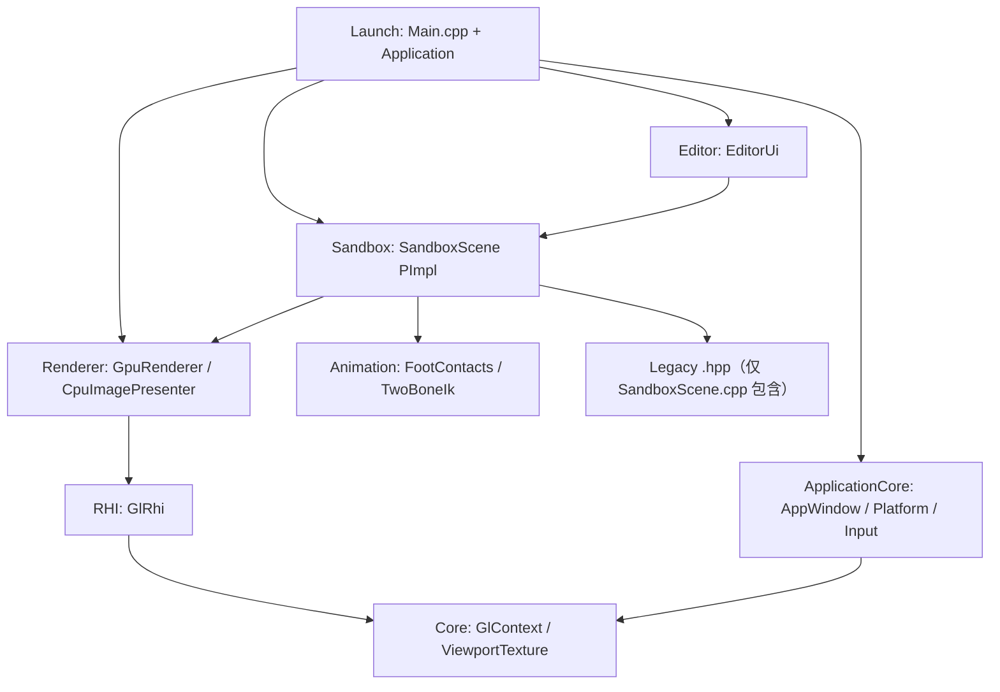
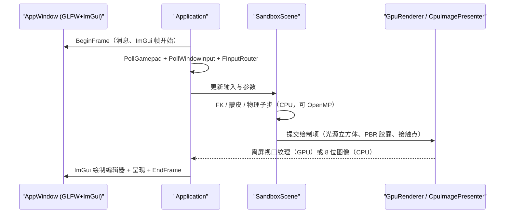

# 项目概述

<cite>
**本文引用的文件**
- [README.md](file://README.md)
- [CMakeLists.txt](file://CMakeLists.txt)
- [vcpkg.json](file://vcpkg.json)
- [Source/Launch/Private/Application.cpp](file://Source/Launch/Private/Application.cpp)
- [Source/Sandbox/Public/SandboxScene.h](file://Source/Sandbox/Public/SandboxScene.h)
- [CHANGELOG.md](file://CHANGELOG.md)
</cite>

## 目录
1. [引言](#引言)
2. [仓库布局](#仓库布局)
3. [分层架构](#分层架构)
4. [运行模式与数据流](#运行模式与数据流)
5. [渲染的等价性约定](#渲染的等价性约定)
6. [验证体系](#验证体系)
7. [性能口径](#性能口径)
8. [结论](#结论)

## 引言
MooLab 2.0（分支 `Version_2.0`）是一个角色运动渲染与仿真沙盒，参考 GAMES101/202/105、Motion Matching 与 raylib 的相关工作。它在 1.x 的基础上完成了三件事：渲染默认走 OpenGL 4.6 GPU 管线、交互层换成 GLFW + Dear ImGui 停靠式编辑器、源码从"单 `main.cpp` + 头文件库"重组为 `Source/` 下的分层模块。1.x 的 CPU 软光栅实现作为**参考路径**保留在 `Source/Legacy`，用于与 GPU 路径逐像素对拍。

对照基准是提交 `fadced7`（v1.09）；逐条改动见 [CHANGELOG.md](file://CHANGELOG.md)。

## 仓库布局
```text
Source/Runtime/Core            Core.h、GlContext.h、ViewportTexture.h（INTERFACE）
Source/Runtime/RHI             GlRhi：GL 对象 RAII、GPU 时间戳、着色器读取
Source/Runtime/Renderer        RenderTypes、GpuRenderer、CpuImagePresenter、PbrShading
Source/Runtime/ApplicationCore Platform（XInput/帧节流）、AppWindow（GLFW/ImGui）、Input
Source/Runtime/Animation       FootContacts、TwoBoneIk（纯数据算法）
Source/Sandbox                 SandboxScene 门面 + SceneTypes + SceneRender/MotionMatching/FootIk.inl
Source/Editor                  EditorUi 停靠式编辑器
Source/Launch                  Main.cpp、Application
Source/Legacy                  1.x 数学/动画/物理/CPU 渲染 .hpp
Shaders/                       GLSL
Tools/ImageDiff、Tools/Verify  对拍工具与自动验证脚本
resources/                     运行数据（character.bin、database.bin、long_motion.bin、foot_contacts.bin、贴图）
.qoder/                        Qoder 智能体（agents）与 repowiki 知识库
```

## 分层架构
依赖方向单向，模块间只暴露 `Public` 头，公共头 basename 全仓唯一（CMake 配置期检查）。



- **Core** 只提供 GL 上下文所有者契约与视口纹理描述，不含 GL、窗口、旧数学头。
- **RHI** 封装 GL 对象生命周期与 GPU 时间戳查询，是唯一直接读着色器文件（`MOOLAB_SHADER_DIR`）的地方。
- **Sandbox** 是 PImpl 门面：唯一包含 `Source/Legacy/*.hpp` 的编译单元，`.inl` 只由它包含并在 CMake 标 `HEADER_FILE_ONLY`，避免 ODR 多重定义。
- **Editor** 只依赖 Sandbox 的公共纯数据与 ImGui，不碰渲染实现。

章节来源
- [CMakeLists.txt](file://CMakeLists.txt)
- [README.md](file://README.md)

## 运行模式与数据流


- **场景模式**：默认 `Physics`（原刚体 + 力矩控制演示）；工具栏可切"角色控制 / Motion Matching"。MM 只读 `long_motion.bin` 与 `database.bin` 在内存中搜索与混合，不改写资源；数据校验失败时禁止进入 MM，Physics 仍可用。
- **输入**：键盘 WASD（按相机水平朝向，S 是转身向后走）、方向键环绕相机、空格暂停、`.` 单步；XInput 手柄左摇杆移动、右摇杆相机。键盘与手柄贡献先相加再做径向死区。鼠标只操作 UI。
- **渲染选择**：`--renderer gpu`（默认）或 `--renderer cpu`（1.x 软光栅 + 8 位量化规则）。
- **资源定位**：`ResourceRoot()` 用编译期绝对路径 `MOOLAB_RESOURCE_DIR`，目录缺失时告警退回 `../resources/`，**不修改进程工作目录**。

## 渲染的等价性约定
GPU 路径刻意保留 CPU 参考实现的非标准行为：非透视插值、纹理 UV 互换与最近邻采样、F0 = albedo、观察空间深度等。因此"对拍通过"证明的是**迁移等价**，不证明 PBR 物理正确。改动任一侧都应以 GPU vs CPU 对拍为准绳。

## 验证体系
- `MooImageDiff a.png b.png`：每像素最大通道差统计，差 ≤3 占比 ≥99%、差 >32 占比 ≤0.5% 为通过；退出码 0/1/2/3 分别为通过、阈值失败、输入错误、尺寸不一致。
- 负对照：`gpu_060.png` 对 `cpu_300.png` 必须失败。
- `Tools/Verify/verify_gl.py`：`capture`（7 组截图 + 历史哈希 + 对拍 + CLI 退出码）、`probe`（GL 探针与 4 个故障用例）、`perf`（3×600 帧）。
- `SceneProbe`：Physics 重置/模式往返的历史帧、暂停/单步、MM 边界与长测运动预算（0 通过、1 硬失败、3 预算失败）。

## 性能口径
- 控制台每帧输出 `Cost`（消息、编辑器 UI、仿真、渲染、显示提交、截图写盘，不含节流等待）、`Interval`（完整帧间隔）、`Gpu`（仅离屏渲染的 GPU 时间戳，滞后若干帧，CPU 模式恒 0）。
- GPU 提交异步，`Cost` 不能当作 GPU 执行时间；60 帧节流下完整帧间隔约 17ms，不能推出 FPS 倍数。
- 当前场景仅光源立方体 + 22 个胶囊 + 接触点；`OMP_WAIT_POLICY=PASSIVE` 可降低 CPU 占用（属于运行库策略，程序未写死）。

## 结论
2.0 把渲染、应用层与场景逻辑拆成明确的模块边界，用"GPU 默认 + CPU 参考"的双路径和一套像素级对拍把迁移风险压到可度量范围内。后续扩展应沿现有依赖方向进行：新算法放 `Runtime/Animation` 或 Sandbox 私有 `.inl`，新 UI 只经 Sandbox 公共数据接入。
